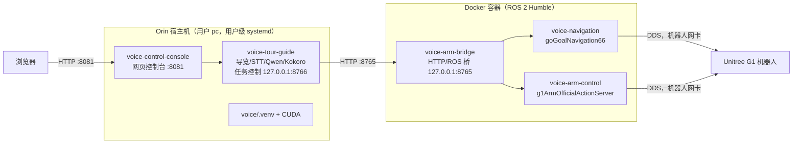

# 本项目 Orin 部署指南

本文说明如何在一台 Jetson Orin 设备（以现有的 `new-orin` 为参照）上，从 `git clone` 拉代码开始，一直做到“基础软件部署完成、通过分层验收”，最后再列出现场接入机器人的顺序。

> **只适用于 Orin 的用户级 systemd 路线。** 旧 NX（`/home/unitree/RobotABrainOnline`、系统级 systemd）的部署方式不适用于 Orin，两条路线不要混用；尤其**不要运行 `voice/scripts/install_services.sh`**，它是 NX 系统级安装脚本，末尾会执行 `systemctl enable --now`，直接把服务启动起来。

本文根据 Codex 历史会话、当前仓库脚本和部署记录整理，更新于 **2026-10-21**。适用代码基线是 `b8495ed`（已包含 Orin 离线部署分支）。下文区分“历史实测结果”和“复现命令”；复现命令本轮只做静态核对，**没有在空白 Orin 上重新安装验收**。

完成安装、CUDA 离线合成、控制台和桥检查，叫“基础软件部署完成”；真实麦克风问答、扬声器听感、机器人导航和手臂动作还要分别验收。缺少匹配的 PyTorch 安装包或 CUDA 库时，必须先备齐材料。

### 历史中实际走过的路线

| 时间 / Codex 会话 | 已确认的过程 |
| --- | --- |
| 2026-07-29「部署项目到 new-orin」 | 同步源码到目标目录；从已有 Humble 基础镜像提取 SDK 到旁目录；本机构建项目镜像；创建 Python 3.10 隔离环境；复用 JetPack 6 PyTorch wheel；补 CUDA 库；下载 Kokoro 三个必要文件；镜像自检、CUDA 合成和 66 项测试通过。 |
| 2026-07-30 至 08-05，同一会话 | 控制台改用用户级服务；8081 曾被 Cap-X 的 Viser 辅助服务占用，临时使用 18081，后来恢复 8081 并开启 Linger。18081 不是项目标准端口。 |
| 2026-09-09「0909 \| 检查 Orin 项目部署状态」 | 补齐五个用户级 unit、配置与库路径；控制台和离线桥启动，运动服务保持停止；34 段台词离线合成通过，随后验证云端 STT/Qwen，并增加无机器人音频调试。 |

会话标识分别为 `019facdc-2fd7-78c0-9517-7f432f9fe5d1`、`01a08431-bb07-7db2-b76d-cbf35b5459e9`，可用于历史追溯。首次部署采用文件同步；本文用 `git clone` 获取源码，未跟踪的运行依赖另行准备。

**版本区别：** 9 月后续历史还提到了 `52bd76e`、`a572261`（独立问答等改动），本地 Git 无法解析这两个提交，当前代码也未包含所述独立问答行为。当前 `nav_route_then_speak.py` 仍会等待导航订阅者，再进入正式导览 `ready`。不要照搬历史后续版本的按钮、暂停或独立问答行为。

---

## 0. 先读懂：部署完成后系统是什么样

### 0.1 一句话

Orin 宿主机（Host，指设备本身的操作系统，而不是容器里）上跑网页控制台、语音识别、问答和语音合成；机器人相关的 ROS 节点全部跑在 Docker 容器里；两边通过本机 HTTP 接口说话。

### 0.2 几个必须先知道的基础概念

| 概念 | 白话解释 |
| --- | --- |
| Git 克隆（git clone） | 把 GitHub 上的代码仓库完整复制一份到本机。 |
| Docker 镜像（image）/ 容器（container） | 镜像像一张“装好全部软件的系统光盘”，容器是用这张光盘临时开起来的一台“小电脑”。本项目的 ROS 环境全装在镜像 `unitree_slam_example_new:humble` 里。 |
| ROS 2 Humble | ROS 2（Robot Operating System 2，机器人操作系统框架）的一个发行版本，负责节点之间收发导航目标、手臂动作等消息。 |
| DDS（Data Distribution Service，数据分发服务） | ROS 2 底层用来在网络上传消息的通信协议；本项目用 Fast DDS 实现，必须绑定到“连机器人的那块网卡”。 |
| 网卡（NIC，Network Interface Card） | 设备上的一个网络接口，例如有线口 `eno1`、回环口 `lo`。回环口（loopback）只能和本机自己通信，`127.0.0.1` 就是它的地址。 |
| systemd / 服务单元（unit） | Linux 管理后台服务的系统；每个服务由一个 `.service` 文件（unit）描述“怎么启动、挂了怎么办”。 |
| 用户级 systemd（`systemctl --user`） | 以普通用户身份管理服务，unit 放在 `~/.config/systemd/user/`，不需要 root。Orin 用的就是这种。**管理本项目五个服务的命令都必须带 `--user`**，不带就会去查系统级服务，结果是“找不到”。 |
| 常驻（Linger） | 让用户级服务在该用户没有登录时也能开机运行的开关。不开的话，不能保证无人登录时服务随系统启动并保持运行。 |
| 虚拟环境（venv，virtual environment） | 给项目单独准备的一套 Python 和第三方库，不污染系统 Python。路径固定为 `voice/.venv`。 |
| CUDA | NVIDIA 显卡/GPU 的计算平台。语音合成模型在 GPU 上跑，依赖 CUDA 动态库。 |
| JetPack | NVIDIA 给 Jetson 系列（含 Orin）出的整套系统包，包含 Ubuntu、驱动和 CUDA；JetPack 版本决定能装哪个版本的 PyTorch。 |
| PyTorch（torch） | 深度学习框架，Kokoro 语音合成依赖它在 GPU 上运行。 |
| STT（Speech-to-Text，语音识别） | 把麦克风声音转成文字；本项目用阿里云 DashScope 的实时识别。 |
| Qwen | 阿里云通义千问大模型，负责回答游客提问，需要联网和 API Key（访问密钥）。 |
| TTS（Text-to-Speech，语音合成） | 把文字合成为语音；本项目用 Kokoro 模型（`hexgrad/Kokoro-82M`，音色 `zm_yunxi`）。 |
| 模型缓存（HF cache） | Kokoro 模型文件从 Hugging Face（一个模型托管网站）下载后存放的目录，本项目固定为 `voice/hf_cache`，运行时强制离线读取。 |
| PulseAudio / ALSA | Linux 的两层音频系统。ALSA（Advanced Linux Sound Architecture）是底层驱动；PulseAudio 是上层“音频服务器”，负责把声音路由到系统默认音响（sink，音频输出端）。 |

### 0.3 部署完成后的运行拓扑



五个服务及其“是否会让机器人动起来”（详见 [PROJECT_GUIDE.md](PROJECT_GUIDE.md) §6）：

| 服务 | 作用 | 会驱动机器人吗 | 部署完成后的预期状态 |
| --- | --- | --- | --- |
| `voice-control-console` | 8081 网页控制台 | 本身不动，但网页按钮能启动下面的运动服务 | active + enabled |
| `voice-arm-bridge` | 宿主与 ROS 之间的 HTTP 桥 | 本身不动，被调用时会转发目标和动作 | active + enabled |
| `voice-navigation` | 导航节点 | **会**：启动即初始化/重定位，收到目标就走 | inactive + disabled |
| `voice-arm-control` | 手臂动作服务 | **会**：收到动作请求就执行 | inactive + disabled |
| `voice-tour-guide` | 常驻预热导览 | 预热本身不走路线；网页“启动导览”后**会** | inactive + disabled |

---

## 1. 整体流程图


| 步骤 | 会驱动机器人吗 | 说明 |
| --- | --- | --- |
| ① ~ ⑨ | 不会 | 安装软件、生成配置、做离线合成与软件验收。⑦ 会启动控制台和桥两个服务，⑧ 的调试会用麦克风和音响。前提是保持 `lo` 配置，且没有另行启动运动节点或点击控制按钮。 |
| ⑩ | **会** | 启动导航、手臂、导览服务，以及网页“启动导览”。**必须在现场确认安全并获得明确授权后才能执行。** |

本文默认路径与账号沿用 new-orin：项目目录 `/mnt/disk1/gt/RobotABrainOnline`，账号 `pc`。换目录后，`install_user_services.py` 会生成相应的服务路径；离线预热和无机器人调试脚本也会自动定位仓库。其他 `start_*.sh` 依赖 unit 注入的环境变量，裸跑可能回退到旧 NX 路径。

除明确标注外，命令都在 **Orin 的普通用户 SSH 终端、项目根目录**执行，不是在 Mac 或容器中执行。`<Orin-IP>`、`/path/to/...` 是占位符，必须换成实际值；`new-orin` 只是原电脑配置的 SSH 别名。

---

## ① 前置条件

**解决什么问题：** 后面每一步都依赖这些基础环境，缺一个就会在中途失败。

| 项目 | 要求 | 状态 |
| --- | --- | --- |
| 硬件 | Jetson Orin，aarch64（ARM 64 位）架构 | 具体型号 **未确认** |
| 系统 / Python / CUDA | 历史为 Ubuntu 22.04、Python 3.10、JetPack 6 系列；检查记录存在 `/usr/local/cuda-12.6` | JetPack 精确小版本、L4T（Jetson 系统底层版本）及驱动组合仍须现场确认；目录名不能证明兼容性 |
| 账号 | 普通用户，new-orin 上是 `pc` | 已知 |
| 公网 | 访问 GitHub、pip 源、Docker 镜像仓库、阿里云 DashScope | 必需 |
| Docker | 包含 `docker compose`（Compose V2 插件）；用户 `pc` 不加 `sudo` 就能执行 `docker` | 必需；如何配置的 **未在仓库中记录** |
| sudo 权限 | 安装系统依赖、配置 Docker 权限或 Linger 时使用 | 普通的输入密码提权即可；历史配置过免密 sudo，但这不是部署前提 |

**如何验证：**

```bash
uname -m                       # 应输出 aarch64
whoami                         # 确认部署用户，历史为 pc
python3 --version              # 历史为 Python 3.10
cat /etc/os-release
cat /etc/nv_tegra_release
dpkg-query -W nvidia-jetpack nvidia-l4t-core  # 元包可能未安装，需结合 L4T 判断
readlink -f /usr/local/cuda
ip -brief addr
ip route
getent hosts dashscope.aliyuncs.com
ss -ltnp | grep -E ':(8081|8765|8766)\b'    # 无输出表示未发现监听
docker ps                      # 不加 sudo 也不报权限错误
docker compose version         # 能输出版本号
curl -sS -o /dev/null -w '%{http_code}\n' https://dashscope.aliyuncs.com   # 能返回一个 HTTP 状态码即说明网络通
```

未携带凭据时 HTTP `401` 只说明服务可达，不是 API Key 验收；`000`、DNS 失败或超时应先修网络。历史网关地址和 Wi-Fi 名称不能直接套用到新现场。

新机还没有 Docker/Compose 时，先按设备的 Ubuntu/JetPack 安装方案准备，达到两个 Docker 检查均成功再继续。如果 Docker 已安装、仅用户无权限，可由管理员将该用户加入已有 `docker` 组，然后退出 SSH 重新登录：

```bash
sudo usermod -aG docker "$(id -un)"
```

准备宿主 Python 和音频构建依赖（Ubuntu 22.04 复现步骤，需要公网和管理员权限）：

```bash
sudo apt-get update
sudo apt-get install -y git curl python3-venv python3-dev python3-pip \
  build-essential libopenblas-dev portaudio19-dev libsndfile1 \
  alsa-utils libasound2-plugins pulseaudio-utils
```

工具安装不等于音频服务器已运行；还需在部署用户下用 `pactl info` 验证系统音频服务。不要以 root 创建 venv 或运行 `systemctl --user`。

**常见失败：**

| 现象 | 原因与处理 |
| --- | --- |
| 有 IP 却上不了公网 | new-orin 踩过：Wi-Fi 连接缺默认网关（gateway）和 DNS（域名解析服务器）。当时是给该连接补齐 `ipv4.gateway`、`ipv4.dns` 后重新应用。改网络前先记下原值，方便回滚。 |
| `docker ps` 报 permission denied | 用户无 Docker 权限。后面的服务全部以用户身份调 `docker compose`，必须先解决。 |
| GitHub / Docker / Hugging Face 超时 | 先排查 DNS 和路由；历史曾用开发电脑的 1082 HTTP 代理经 SSH 反向转发，见附录 C。Docker 守护进程不自动继承终端代理。 |

---

## ② 拉代码

**解决什么问题：** 把项目代码放到 Orin 上。

```bash
mkdir -p /mnt/disk1/gt
cd /mnt/disk1/gt
git clone https://github.com/firmiana114/RobotABrainOnline.git
cd RobotABrainOnline
```

**如何验证：**

```bash
git status --short             # 无输出表示工作区干净
git rev-parse --short HEAD     # 记下当前提交号
ls voice/scripts/install_user_services.py
```

**要知道的事：** 下列内容被 `.gitignore`（Git 忽略清单）排除，克隆下来**没有**，必须在后面的步骤里自己准备：

| 路径 | 内容 | 在哪一步准备 |
| --- | --- | --- |
| `voice/.venv/` | Python 虚拟环境 | ④ |
| `voice/hf_cache/` | Kokoro 模型缓存 | ⑤ |
| `voice/runtime/` | 密钥、部署配置、日志、派生文件 | ⑥ ⑦ |
| `runtime/` | 根目录的 Fast DDS 生成配置 | 运行脚本时自动生成 |
| `../RobotABrainOnline-runtime/lib` | CUDA 库修补用的旁目录（在仓库外） | ④ |
| `voice/conf/*_route.json`、`voice/guide_qa_context.txt` | 由台词文件派生的路线和问答上下文 | 运行时自动生成 |

`voice/guide_cache/` 里已有一部分预生成语音被提交在 Git 中，缺的会在 ⑧ 预热时补齐。

---

## ③ Docker 镜像与 ROS 节点

**解决什么问题：** 导航、手臂和 HTTP 桥都在容器里运行，需要镜像 `unitree_slam_example_new:humble`。这个镜像已经内置 Unitree SDK2（宇树机器人官方开发包，约 411 MB）、自定义 Action（ROS 2 的“长任务”消息类型）和六个 C++ 节点，所以**有镜像就能跑，不需要在宿主机上编译**。

获取镜像有两条路：

| 方式 | 命令 | 前提 | 状态 |
| --- | --- | --- | --- |
| A. 自己构建 | `UNITREE_SDK2_CONTEXT="$PWD-runtime/unitree_sdk2" ./docker/build_image.sh` | 旁目录已有完整 SDK；基础镜像 `ghcr.io/aaronai/rabbitbot-nav-portable:20260611` 可用 | 历史实际采用此方式；SDK 从服务器已有 Humble 基础镜像提取，提取源路径与镜像公开访问权限未确认 |
| B. 从已有设备导入 | `docker save` 导出、传输后 `docker load` 导入 | 维护者提供与目标源码匹配的 aarch64 项目镜像 | 新手可选的复现方式，不是历史首次部署采用的方式 |

新手可先向维护者索取已验证镜像，减少现场编译问题。以下是方式 B 的复现命令。在已有正确镜像的设备上，进入空间充足的导出目录：

```bash
docker save -o unitree_slam_example_new-humble.tar unitree_slam_example_new:humble
sha256sum unitree_slam_example_new-humble.tar > unitree_slam_example_new-humble.tar.sha256
```

用移动硬盘或文件传输工具将两个文件送到目标 Orin 的 `../RobotABrainOnline-runtime/images/`。在目标 Orin 项目根目录执行：

```bash
(cd ../RobotABrainOnline-runtime/images && sha256sum -c unitree_slam_example_new-humble.tar.sha256)
# 必须看到 OK 后再导入
docker load -i ../RobotABrainOnline-runtime/images/unitree_slam_example_new-humble.tar
docker image inspect unitree_slam_example_new:humble --format '{{.Architecture}}'
```

架构应为 `arm64`。校验和只能确认传输完整性；镜像标签相同不证明节点版本一致，要同时记录提供方的 Git 提交和镜像 ID。已有同标签镜像时先保留旧镜像，再导入。

方式 A 的细节：`docker/build_image.sh` 默认找 `/mnt/ssd/navgation/projects/unitree_sdk2`，Orin 上通常没有这个路径，需要用 `UNITREE_SDK2_CONTEXT` 指到实际位置。脚本会先检查这四样东西存在，缺一个就退出：

```text
<sdk>/include
<sdk>/lib/aarch64/libunitree_sdk2.a
<sdk>/thirdparty/lib/aarch64/libddsc.so
<sdk>/thirdparty/lib/aarch64/libddscxx.so
```

**如何验证（临时容器自检，不启动机器人节点）：**

```bash
docker image inspect unitree_slam_example_new:humble >/dev/null && echo image-ok
docker run --rm unitree_slam_example_new:humble check
```

`check` 成功时最后一行包含 `embedded runtime check passed nodes=6`，表示 SDK、自定义 Action、六个节点和它们依赖的动态库都完整。

**可选：修改了 C++ 源码才需要重新编译。**

```bash
ROS_INTERFACE=lo ./docker/build_example.sh
```

**常见失败与坑：**

| 现象 | 原因与处理 |
| --- | --- |
| `Missing Unitree SDK build context component` | `UNITREE_SDK2_CONTEXT` 没指对或 SDK 不完整。 |
| `Required image is not available` | 运行 `build_example.sh` 前没有镜像，先完成上面的 A 或 B。 |
| `Unable to resolve IPv4 address for ROS interface: eth0` | `build_example.sh` 会生成 DDS 配置，没指定网卡时自动找 `192.168.123.*` 网段，找不到就用 `eth0`；Orin 上没有 `eth0` 就失败。没连机器人时用 `ROS_INTERFACE=lo`。 |
| 编译后运行的是新编译版本 | 反直觉：一旦 `example/build_docker/` 里有编译产物，运行时会**优先用挂载的编译产物**而不是镜像内置节点。想回到镜像版本，可在停止相关服务后将该目录改名备份，不必删除。 |

---

## ④ Python 环境与 CUDA 库

**解决什么问题：** 控制台、导览、语音识别、问答、语音合成都在宿主机的 `voice/.venv` 里运行，所有服务脚本都直接调用 `voice/.venv/bin/python`，这个解释器不存在服务就起不来。

### 4.1 架构硬约束（无论怎么装都必须遵守）

- 宿主 venv **不 source ROS、不 import `rclpy`（ROS 2 的 Python 库）、不装 `custom_action_interfaces`**。所有 ROS 相关内容只在容器里。原因：宿主的 CUDA/PyTorch/Python 版本组合与 ROS 的依赖混在一起容易产生库冲突。
- venv 路径必须是 `voice/.venv`（脚本写死了这个位置）。

### 4.2 Python 3.10 隔离环境与历史依赖

历史明确记录：创建 Python 3.10 venv，起初曾借用用户环境，后来改成**不继承系统包的隔离环境**，防止其他 AI 项目的 torchvision、transformers 等包干扰。

9 月 9 日历史命令输出中的主要版本：

| 包 | 历史版本 |
| --- | --- |
| torch | wheel 文件名 `2.5.0a0+872d972e41.nv24.8`；导入输出为 `2.5.0a0+872d972e41.nv24.08` |
| kokoro / misaki | 都为 `0.9.4` |
| numpy / scipy | `1.24.4` / `1.10.1` |
| fastapi / uvicorn / pydantic | `0.115.14` / `0.30.6` / `2.10.6` |
| dashscope / openai | `1.26.4` / `2.50.0` |
| PyAudio / soundfile | `0.2.14` / `0.13.1` |
| spacy / transformers | `3.7.5` / `4.46.3` |
| httpx / pytest | `0.27.2` / `8.4.2` |

历史 wheel 位于 `../RobotABrainOnline-runtime/wheels/torch-2.5.0a0+872d972e41.nv24.8-cp310-cp310-linux_aarch64.whl`。`cp310` 表示 Python 3.10，`aarch64` 表示 ARM 64 位。**原始下载 URL、文件校验和和精确 JetPack 配套版本没有找全**。先向维护者取得已验证安装包与匹配的运行库；换 JetPack 时按 [NVIDIA 官方 Jetson PyTorch 安装说明](https://docs.nvidia.com/deeplearning/frameworks/install-pytorch-jetson-platform/index.html)核对，不要直接安装 PyPI 默认 torch。官方还要求 24.06 及之后的 NVIDIA PyTorch 先准备 cuSPARSELt。

下列是根据历史与仓库依赖整理的**复现步骤**，不是任意 JetPack 通用的安装器。先完成 4.3 的运行库准备；已有可用 venv 时先检查，不要覆盖重建。

```bash
python3.10 -m venv voice/.venv
voice/.venv/bin/python -m pip install --upgrade pip setuptools wheel
export LD_LIBRARY_PATH="$PWD-runtime/lib:/usr/local/cuda/lib64:${LD_LIBRARY_PATH:-}"

# 安装包须事先提供并核对兼容性
voice/.venv/bin/python -m pip install \
  ../RobotABrainOnline-runtime/wheels/torch-2.5.0a0+872d972e41.nv24.8-cp310-cp310-linux_aarch64.whl

# nx 命名表示历史依赖集；这些版本也用于 Python 3.10 复现
voice/.venv/bin/python -m pip install \
  -r voice/requirements-nx-console.txt -r voice/requirements-nx-tour.txt
```

再安装 Kokoro 及语言依赖。这里沿用仓库脚本的显式清单；`--no-deps` 避免安装 Kokoro/Misaki 时换掉 Jetson torch，最后必须通过 `pip check`：

```bash
voice/.venv/bin/python -m pip install --no-deps kokoro==0.9.4 misaki==0.9.4
voice/.venv/bin/python -m pip install \
  'huggingface-hub<1' loguru 'transformers<4.47' addict regex \
  espeakng-loader num2words phonemizer-fork 'spacy<3.8' \
  'spacy-curated-transformers<0.3' cn2an jieba ordered-set pypinyin pypinyin-dict
voice/.venv/bin/python -m spacy download en_core_web_sm
voice/.venv/bin/python -m pip check
```

中文台词可能夹有英文，所以 `en_core_web_sm`（英文语言处理模型）也要在联网安装阶段准备好。requirements 使用版本范围，今天解析的结果可能不同于历史表；成功后记录实际版本：

```bash
mkdir -p voice/runtime
voice/.venv/bin/python -m pip list --format=freeze > voice/runtime/deployed-packages.txt
```

`pip check` 有冲突就先停止后续步骤并核查包名/版本。当前 `requirements-control-console.txt` 是另一套较新的范围，本指南选用与历史一致的 `requirements-nx-console.txt`。**不要运行 `install_nx_venv.sh`**：它使用 Python 3.8 包路径、JetPack 5.1.1 wheel、继承系统包并修改包文件，这些操作不适用于这里的 Python 3.10。

### 4.3 CUDA 库的坑：`libcusparseLt.so.0` 链接错误

new-orin 实测踩过：系统 CUDA 目录里的 `libcusparseLt.so.0` 是一个**错误的符号链接**（symlink，类似快捷方式），指向了 `libcusparse.so`（名字很像但是另一个库），导致 torch 加载失败。

当时的处理方式是**不改系统库**，而是在仓库**旁边**建一个目录放正确的库，再用 `LD_LIBRARY_PATH`（动态库搜索路径环境变量，排在前面的目录优先）让程序先找到它：

```text
/mnt/disk1/gt/RobotABrainOnline           ← 仓库
/mnt/disk1/gt/RobotABrainOnline-runtime/lib  ← 放正确的 libcusparseLt.so.0
```

这个路径不需要手动配置：`install_user_services.py`、`prewarm_offline.sh`、`debug_tour_no_robot.sh` 都默认把 `<仓库路径>-runtime/lib` 加到 `LD_LIBRARY_PATH` 最前面；也可以用环境变量 `VOICE_RUNTIME_LIB` 改成别的目录。

历史确认旁目录内已有真正的 aarch64 `libcusparseLt.so.0`，以及 `libportaudio.so*`、`include/portaudio.h`。PyAudio 头文件当初从已有容器提取；新设备可用前面的 `portaudio19-dev` 提供。cuSPARSELt 的原始发行包与具体版本仍 **未确认**，不可把 `libcusparse.so` 改名代替。

复用匹配环境时，让维护者提供正确库及来源/校验和，在目标项目根目录准备：

```bash
mkdir -p ../RobotABrainOnline-runtime/lib
# 将已核对的 aarch64 libcusparseLt.so.0 放到以上目录
file ../RobotABrainOnline-runtime/lib/libcusparseLt.so.0
```

应识别为 ARM aarch64 共享库；这只能检查架构，兼容性最终要以 CUDA 运算为准。

先检查本机是否有同样的问题：

```bash
ls -l /usr/local/cuda/lib64/ | grep -i cusparse
```

如果 `libcusparseLt.so.0` 指向 `libcusparse.so...`，就是同一个坑。

### 4.4 如何验证

```bash
test -x voice/.venv/bin/python && echo venv-ok
LD_LIBRARY_PATH="$PWD-runtime/lib:/usr/local/cuda/lib64" \
  voice/.venv/bin/python - <<'PY'
import dashscope, kokoro, misaki, openai, pyaudio, torch
print("torch=", torch.__version__, "cuda=", torch.cuda.is_available())
assert torch.cuda.is_available(), "CUDA unavailable"
print("gpu_sum=", torch.ones(3, device="cuda").sum().item())
PY
voice/.venv/bin/pip check
```

期望：输出 `cuda= True`、`gpu_sum= 3.0`；`pip check` 无冲突（历史实测如此）。

| 现象 | 原因与处理 |
| --- | --- |
| `cuda= False` | 可能是 torch/JetPack 不匹配、驱动或运行库问题；先核对版本和报错，不能仅凭 False 确定原因。 |
| 导入 torch 时报 `libcusparseLt` 相关错误 | 见 4.3。 |
| 服务日志 `Python is unavailable path=.../voice/.venv/bin/python` | venv 不在 `voice/.venv`。 |

---

## ⑤ 模型缓存 `voice/hf_cache`

**解决什么问题：** 导览和离线验证脚本默认以模型离线模式运行（`HF_HUB_OFFLINE=1`，即不联网下载模型），所以 Kokoro 模型必须事先放进 `voice/hf_cache`（实际读取 `voice/hf_cache/hub`）。

需要的模型：`hexgrad/Kokoro-82M`，音色 `zm_yunxi`（正式导览可用 `KOKORO_REPO_ID`、`KOKORO_VOICE` 覆盖；音色必须属于所选模型。本文离线预热脚本使用代码默认模型/音色）。

**历史做法已找到：** 同盘 `RobotAbrainOffline` 的平铺模型不能直接当作本项目的 Hugging Face 缓存；当时经代理下载配置、权重和 `zm_yunxi` 音色三个文件。只把 `.pth` 放进任意目录不够。

下面用官方 `hf_hub_download` API 复现缓存结构；联网开关只作用于本次下载，项目运行脚本仍离线加载。文件名见 [Kokoro 模型仓库](https://huggingface.co/hexgrad/Kokoro-82M/tree/main)，缓存行为见 [Hugging Face 下载说明](https://huggingface.co/docs/huggingface_hub/guides/download)。

```bash
HF_HUB_OFFLINE=0 voice/.venv/bin/python - <<'PY'
from huggingface_hub import hf_hub_download
for filename in ("config.json", "kokoro-v1_0.pth", "voices/zm_yunxi.pt"):
    path = hf_hub_download(
        repo_id="hexgrad/Kokoro-82M",
        filename=filename,
        cache_dir="voice/hf_cache/hub",
    )
    print(path)
PY
```

权重约 327 MB，下载时间取决于网络。默认下载模型仓库当前 main；历史模型 revision 未记录，严格复现时可复制已验证设备的整个 `voice/hf_cache/`，保留 `blobs`、`refs`、`snapshots` 及符号链接并记录 revision。不要只复制 snapshots 中的链接。

**如何验证：** 直接用 ⑧ 的离线预热验证——能合成出语音就说明缓存可用。

```bash
test -d voice/hf_cache/hub && echo cache-dir-ok
```

**常见失败：** 预热报找不到模型或尝试联网 → 缓存缺失或不在 `voice/hf_cache/hub` 下。

---

## ⑥ 运行时配置与密钥

**解决什么问题：** 密钥、网卡名、音频设备名因设备而异，不能写进 Git，统一放在 `voice/runtime/`。

先生成配置模板和用户服务（**不启动服务**），再编辑配置，无需来回跳转章节：

```bash
python3 voice/scripts/install_user_services.py
```

脚本首次创建下面两个文件，权限为 0600（只有文件主人可读写），已存在则不覆盖。完整行为见 ⑦。

| 文件 | 内容 | 模板默认值 |
| --- | --- | --- |
| `voice/runtime/deployment.env` | 机器人网卡 | `ROS_INTERFACE=lo`（只用回环口，即“机器人离线”模式） |
| `voice/runtime/voice.env` | 密钥与语音设备 | `DASHSCOPE_API_KEY=`（空）、`QWEN_MODEL=qwen-plus`、`KOKORO_REPO_ID=hexgrad/Kokoro-82M`、`KOKORO_VOICE=zm_yunxi`、`ALSA_INPUT_DEVICE=plughw:CARD=Rx,DEV=0`、`SPEAKER_NAME=...` |

### 6.1 填密钥

用文本编辑器打开 `voice/runtime/voice.env`，在 `DASHSCOPE_API_KEY=` 后填入阿里云 DashScope 的 Key。**不要用 `cat` 打印这个文件，不要提交到 Git，不要贴到聊天或日志里。**

**如何验证（不泄露内容）：**

```bash
stat -c '%a' voice/runtime/voice.env                        # 应为 600
grep -c '^DASHSCOPE_API_KEY=.\+' voice/runtime/voice.env    # 只粗查非空；引号/空格也可能被计入，不证明密钥有效
```

### 6.2 填音频设备

| 方向 | 说明 | 查看命令 |
| --- | --- | --- |
| 麦克风 | `ALSA_INPUT_DEVICE` 必须与实际麦克风一致（例如 `plughw:CARD=MINI,DEV=0`） | `arecord -l` |
| 音响 | 默认走 PulseAudio 系统默认输出（`aplay -D pulse`），**不再按 `SPEAKER_NAME` 匹配**；需要在系统里把目标音响设为默认 | `pactl list short sinks`，`pactl set-default-sink <sink名>` |

USB 音响只被识别为串口不代表能出声，要在 `pactl list short sinks` 里能看到才算可用。

### 6.3 网卡

部署阶段保持 `ROS_INTERFACE=lo` 不动。连机器人时再改，见 ⑩。

---

## ⑦ 用户级 systemd 服务

**解决什么问题：** 让五个服务能被 systemd 管理、开机自启，并且网页控制台能通过用户级 systemd 管理它们。

### 7.1 生成并安装 unit（不启动任何服务）

```bash
python3 voice/scripts/install_user_services.py
```

这个脚本做了什么：

| 动作 | 说明 |
| --- | --- |
| 改写 unit | 读 `voice/deploy/systemd/*.service`，把 NX 路径替换为当前仓库路径，去掉 `User=unitree`，安装目标改为 `default.target`，`NAV_IFACE` 默认改为 `eno1` |
| 注入环境 | 每个 unit 加上 `LD_LIBRARY_PATH=<仓库>-runtime/lib:/usr/local/cuda/lib64`、`VOICE_SYSTEMCTL_PATH`、空的 `VOICE_CONSOLE_SUDO`（控制台不用 sudo），并读取 `voice/runtime/deployment.env` |
| 写到 | `~/.config/systemd/user/` |
| 生成包装器 | `voice/runtime/systemctl-user`，内容就是 `systemctl --user`，供控制台网页管理用户级服务 |
| 生成模板 | 首次运行时生成 ⑥ 的两个配置文件，已存在则不覆盖 |
| 收尾 | 执行 `systemctl --user daemon-reload`（让 systemd 重新读取 unit），**不启动、不 enable 任何服务** |

成功时输出 `Installed user services. No service was started. Robot NIC default: eno1.`。⑥ 已执行过便无需重复。换目录或更新 unit 后可以重新生成；运行中的服务需在合适时机重启才会采用新路径。venv 不保证可随目录迁移，应另行检查或重建。

### 7.2 开启 Linger

```bash
sudo loginctl enable-linger "$(id -un)"
loginctl show-user "$(id -un)" -p Linger     # 应输出 Linger=yes
```

`loginctl enable-linger` 是 systemd 的标准命令，仓库里只记录了 new-orin 的结果为 `Linger=yes`。

### 7.3 启用控制台和桥

部署完成后的预期是：控制台与桥 active + enabled，其余三个 inactive + disabled。安装脚本不会 enable，需要操作者执行：

```bash
systemctl --user enable --now voice-control-console voice-arm-bridge
```

> 这一步会启动两个服务。先确认 `deployment.env` 中 `ROS_INTERFACE=lo`，三个运动相关服务没有运行；不要 enable 导航、手臂、导览。`lo` 约束桥的 DDS 通信，不是阻止其他服务启动的开关，网页按钮仍能管理服务。部署阶段只查看状态。

用户级 unit 保留的 `Wants=docker.service` 不能代替系统 Docker 守护进程的启动。要保证重启后桥可用，还需管理员确认 `systemctl is-active docker` 和 `systemctl is-enabled docker`；当前 user unit 在 Docker 未就绪时可能失败重试。

**如何验证：**

```bash
systemctl --user is-active voice-control-console voice-arm-bridge    # 都是 active
curl -s http://127.0.0.1:8765/healthz                                # 返回 {"ok": true, "service": "voice-humble-bridge"}
curl -s -o /dev/null -w '%{http_code}\n' http://127.0.0.1:8081/       # 200
journalctl --user -u voice-arm-bridge -n 50                          # 查看日志
```

**常见失败：**

| 现象 | 原因与处理 |
| --- | --- |
| `Unit ... not found` | 命令漏了 `--user`。 |
| SSH 断开后服务停了 | 检查 Linger 和日志，用户会话生命周期可能是原因。 |
| 桥日志 `Unable to resolve IPv4 address for ROS interface` | `deployment.env` 里的网卡不存在或没 IP。 |
| 桥起不来、docker 权限错误 | 见 ①；加组后需重新登录，旧用户服务管理器也可能仍持有旧组权限，可安排设备重启后复查。 |
| 控制台日志 `address already in use` | 用 `ss -ltnp` 确认 8081 的占用者；历史曾是 Cap-X/Viser。由对应服务维护者调整端口，不要随意杀进程。 |
| `Failed to connect to bus` | 检查是否用部署用户正常 SSH 登录，及 `/run/user/$(id -u)`；不要使用 `sudo systemctl --user`。 |

---

## ⑧ 离线预热与无机器人调试

### 8.1 离线预热（不需要 Key，不连机器人）

**解决什么问题：** 一次性把正式路线 `voice/conf/dialogue_0.json` 的所有台词合成为语音缓存，同时验证 venv、CUDA 库、模型缓存三者能协同工作。

```bash
voice/scripts/prewarm_offline.sh
```

它只做语音合成：不创建云端客户端、不录音、不播放、不调用机器人。还会额外强制合成一句“离线语音部署验证。”作为探针，确保真的跑了一次 GPU 推理而不是全部命中缓存。

**如何验证：** 最后一行输出一行 JSON，字段为 `cuda`（应为 true）、`segments`（台词段数）、`generated`（本次新合成段数）、`audio_seconds`（总时长）。new-orin 实测为 34 段台词、总时长约 496 秒（约 8 分钟）。每段都会校验能读取、采样率为 24000 Hz、数据没有异常值。派生路线和探针文件写在 `voice/runtime/`，不进 Git。

| 现象 | 原因与处理 |
| --- | --- |
| `CUDA unavailable` | torch 或 CUDA 库问题，回到 ④。 |
| 模型加载失败 | 模型缓存问题，回到 ⑤。 |

### 8.2 无机器人语音调试（需要 Key 和网络，会用麦克风和音响，不连机器人）

**解决什么问题：** 在机器人不在线时，用真实麦克风、真实云端识别和问答、真实外放走一遍导览流程，导航和手臂用进程内模拟代替（手臂请求只打印 `[SIMULATION]`）。详细用法见 [voice/DEBUG_NO_ROBOT.md](voice/DEBUG_NO_ROBOT.md)。

```bash
voice/scripts/debug_tour_no_robot.sh --check    # 短暂采集 1 秒并播放静音，检查后退出
voice/scripts/debug_tour_no_robot.sh            # 跑第一个路线项；说“小智，……”可打断提问；Ctrl+C 停止
```

注意：调试默认麦克风是 DJI MIC MINI（`plughw:CARD=MINI,DEV=0`），可用 `--mic` 指定别的；**不要和正式导览服务同时运行**，会争抢麦克风。

**如何验证：** `--check` 正常退出；完整运行能听到播报、能被“小智”打断并回答。`--check` 只证明设备能打开，不证明现场听得见。

---

## ⑨ 分层验收（部署完成的判定）

**解决什么问题：** 区分文件存在、进程正常、语音可用和机器人现场可用。先做只读查询；镜像自检和单元测试单列，因为它们会创建临时容器或测试文件，不能称为完全只读。

```bash
cd /mnt/disk1/gt/RobotABrainOnline

# 代码
git status --short
git rev-parse --short HEAD

# 服务状态（必须带 --user）
systemctl --user is-enabled voice-control-console voice-arm-bridge voice-navigation voice-arm-control voice-tour-guide
systemctl --user is-active  voice-control-console voice-arm-bridge voice-navigation voice-arm-control voice-tour-guide
loginctl show-user "$(id -un)" -p Linger

# 运行文件（不输出密钥内容）
test -x voice/.venv/bin/python && echo venv-ok
stat -c '%a' voice/runtime/voice.env
test -d voice/hf_cache && echo cache-ok
docker image inspect unitree_slam_example_new:humble >/dev/null && echo image-ok

# 本机接口（只用 GET 读取）
curl -s http://127.0.0.1:8765/healthz
curl -s http://127.0.0.1:8765/nav_state
curl -s -o /dev/null -w '%{http_code}\n' http://127.0.0.1:8081/

```

`is-active` / `is-enabled` 一次查询多个服务时，预期的 `inactive` / `disabled` 可能使命令返回非零；逐行对照，不要简单以退出码判定部署失败。

再执行不调用机器人动作的检查：

```bash
# 创建临时容器，只检查节点及依赖，不启动节点
docker run --rm unitree_slam_example_new:humble check
# 单元测试会创建临时数据/缓存；使用项目运行库路径
LD_LIBRARY_PATH="$PWD-runtime/lib:/usr/local/cuda/lib64:${LD_LIBRARY_PATH:-}" \
  voice/.venv/bin/python -m pytest -q voice/tests
```

**通过标准：**

| 检查项 | 期望结果 |
| --- | --- |
| is-enabled | 控制台、桥为 `enabled`；导航、手臂、导览为 `disabled` |
| is-active | 控制台、桥为 `active`；其余为 `inactive` |
| Linger | `Linger=yes` |
| voice.env 权限 | `600` |
| 镜像 check | `embedded runtime check passed nodes=6` |
| `/healthz` | `"ok": true` |
| `/nav_state` | `goal_subscribers` 为 0（导航没启动，与机器人离线一致） |
| 控制台首页 | `200` |
| pytest | 当前版本的测试全部通过；历史 77 项只作参考，不要求测试数量固定 |

`curl http://127.0.0.1:8766/status` 此时连不上是正常的，因为导览服务还没启动。

**重要：** 这些检查加上 ⑧ 的 CUDA 离线预热通过，才代表基础软件部署验收完成；云端和音频需另验。它们**不代表机器人在线，也不代表导览就绪**。此时不要在网页上点“重启导览服务”或启动导航、手臂相关按钮。

---

## ⑩ 现场接入机器人（会驱动机器人）

> ⚠️ **以下第 3 步起进入可能触发真实机器人动作的阶段。必须在现场确认周围安全、有人监护并获得明确授权后，才能执行。** 已找到的部署记录没有提供完整真实导航/手臂验收证据，本轮也未连接 Orin 检查当前状态。

| 顺序 | 操作 | 驱动机器人吗 |
| --- | --- | --- |
| 1 | 确认 ⑥ 的 Key 已填、音频设备名与实际一致 | 不会 |
| 2 | 确认机器人连在哪块网卡、该网卡已有 IP 后，在 `voice/runtime/deployment.env` 里把 `ROS_INTERFACE` 和 `NAV_IFACE` **都**设为该网卡（例如都为 `eno1`）；再 `systemctl --user restart voice-arm-bridge` 并检查 `curl -s http://127.0.0.1:8765/healthz` | 不会 |
| 3 | `systemctl --user start voice-navigation`，看状态和日志 | **会**（启动即初始化/重定位） |
| 4 | `systemctl --user start voice-arm-control`，看状态和日志 | **会**（收到请求即动作） |
| 5 | `systemctl --user start voice-tour-guide`，等待预热；`curl -s http://127.0.0.1:8766/status` 必须显示真实预热就绪 | 预热本身不走路线 |
| 6 | 通过网页 `http://<Orin-IP>:8081` 手动启动导览 | **会** |

开始第 3 步前，还要确认 `voice/conf/dialogue_0.json`（或当前选定的台词文件）内的地图路径和点位适用于现场。地图路径由机器人 PC1 的 SLAM 服务解析，不能仅凭 Orin 上存在同名文件判定地图正确。坐标需在对应地图上验证，不能直接用示例路线让机器人行走。

每一步都用 `systemctl --user status <服务>` 和 `journalctl --user -u <服务> -n 50` 检查后再进行下一步。服务 `active` 只表示进程运行，不代表定位、麦克风或语音识别成功；当前导览代码允许 STT 失败时降级为仅播报，需同时检查 `[startup] stt_ready` 的 `enabled` 和实际提问结果。

**这一段的坑（反直觉，最容易出错）：**

| 坑 | 说明 |
| --- | --- |
| 两个网卡变量必须一起改 | 桥用 `ROS_INTERFACE`，导航和手臂用 `NAV_IFACE`；但导航/手臂启动脚本生成 DDS 配置时会**优先读 `ROS_INTERFACE`**。如果只改了 `NAV_IFACE`、`ROS_INTERFACE` 还是 `lo`，导航的 DDS 会绑在回环口上，连不到机器人。 |
| `deployment.env` 不会配置网卡 | 它只告诉程序用哪块网卡，网卡本身的 IP、路由要另外配好。new-orin 部署时 `eno1` 无链路，未改过 IP 或路由。 |
| 当前版本没有导航订阅者时正式预热失败 | 导览预热会检查导航节点是否在接收目标（`/go_goal_pose` 订阅者），没有就直接失败；这是设计如此，不要绕过。 |
| 改了台词、模型或音色后 | 需要重启导览服务重新预热，否则新台词会在导览时临时合成。 |

---

### 日常停止与下一次开机

关闭当前导览任务、保留预热进程：

```bash
curl -sS -X POST http://127.0.0.1:8766/stop
```

结束当天运行时，按顺序停止常驻导览和运动节点：

```bash
systemctl --user stop voice-tour-guide
systemctl --user stop voice-navigation
systemctl --user stop voice-arm-control
systemctl --user stop voice-arm-bridge
```

按本文配置，下一次开机只自动启动控制台和桥，导航、手臂和导览仍需现场启动。`stop` 不取消自启；若不希望桥下次开机恢复，在结束运行后执行 `systemctl --user disable voice-arm-bridge`。停止导览不会自动停止所有运动节点，也不是机器人急停；有现场风险时使用硬件急停。

### 软件升级时保留什么

先结束现场任务，记录提交号和 `git status --short`，再获取维护者确认的代码版本。不要用覆盖式拷贝或 `git reset --hard` 丢弃本地配置/台词修改。保留 `voice/runtime`、`voice/hf_cache`、依赖清单及旁目录运行库；密钥备份保持私密。更新 C++ 时同步重建/替换镜像或编译产物，更新 unit 时重新生成服务，更新依赖后重新 `pip check`，然后重复离线预热和音频验收。

## 附录 A：名词速查表

| 名词 | 解释 |
| --- | --- |
| aarch64 | ARM 64 位 CPU 架构，Jetson 设备使用。 |
| CUDA | NVIDIA GPU 计算平台。 |
| DashScope | 阿里云的大模型服务平台，提供 STT 和 Qwen。 |
| DDS / Fast DDS | ROS 2 底层网络通信协议及其一种实现。 |
| Docker 镜像 / 容器 | 打包好的运行环境 / 由镜像启动的隔离运行实例。 |
| JetPack | NVIDIA Jetson 的系统软件包，决定 CUDA 和可用的 PyTorch 版本。 |
| `LD_LIBRARY_PATH` | 程序加载动态库时优先搜索的目录列表。 |
| Linger | 让用户级服务在用户未登录时也运行的开关。 |
| PulseAudio / ALSA / sink | 上层音频服务器 / 底层音频驱动 / 音频输出端。 |
| Qwen | 通义千问大模型，负责问答。 |
| ROS 2 Humble | 机器人操作系统框架的一个版本。 |
| STT / TTS | 语音识别 / 语音合成。 |
| systemd / unit / `--user` | Linux 服务管理器 / 服务描述文件 / 用户级模式。 |
| venv | Python 虚拟环境。 |
| 回环口 `lo` | 只能与本机通信的虚拟网卡，地址 `127.0.0.1`。 |
| 符号链接（symlink） | 指向另一个文件的“快捷方式”。 |
| 预热 | 提前加载模型、合成整条路线语音，让正式导览启动时不用等待。 |

## 附录 B：仍须补齐的部署材料

历史已补齐 Python 主版本、torch wheel 名称、SDK 取得方式与模型下载方式。以下仍没有充分证据，不能写成已验证：

1. new-orin 的具体硬件型号、精确 JetPack/L4T/驱动组合；新设备是否与历史一致。
2. 历史 torch wheel 的原始下载地址与校验和；正确 cuSPARSELt 的具体版本、发行包与校验和。
3. Humble 基础镜像访问权限、SDK 在该镜像中的原始路径、新镜像与目标源码提交的对应关系。
4. 历史完整 Python 依赖锁定清单和 Kokoro revision；正文的主要版本表不能代替完整锁定文件。
5. 新现场网卡/IP、地图与路线点位、麦克风/音响型号，以及真实导航和手臂验收结果。

新设备的最小材料包应包括：源码提交号、已验证 aarch64 项目镜像与校验和、匹配的 torch wheel/CUDA 库、依赖清单、完整模型缓存（或可访问下载源）、部署用户及现场网络说明。API Key 单独在设备上填写，不放进共享安装包。

## 附录 C：网络受限时的历史代理方式

历史使用开发电脑本地 `1082` HTTP 代理，通过 SSH **反向转发**供 Orin 使用。以下为复现示例，仅当电脑已有可用 HTTP 代理、远端端口空闲时使用。

在开发电脑执行并保持终端打开（将 `new-orin` 换成实际 SSH 别名或 `用户@地址`）：

```bash
ssh -N -o ExitOnForwardFailure=yes -R 127.0.0.1:1082:127.0.0.1:1082 new-orin
```

在另一个 Orin 终端给安装/下载进程设置：

```bash
export HTTP_PROXY=http://127.0.0.1:1082
export HTTPS_PROXY=http://127.0.0.1:1082
export NO_PROXY=localhost,127.0.0.1
```

安装后执行 `unset HTTP_PROXY HTTPS_PROXY NO_PROXY` 并关闭隧道。不要把开发电脑临时代理写进常驻服务；电脑断开后它就不可用了。该方法不能自动代理 Docker 守护进程，镜像拉取仍失败时优先使用镜像文件导入。

## 相关文档

- [README.md](README.md)：部署完成后的正式导览启动说明（以 NX 为例）。
- [PROJECT_GUIDE.md](PROJECT_GUIDE.md)：架构、服务、配置项和诊断的完整说明。
- [voice/DEBUG_NO_ROBOT.md](voice/DEBUG_NO_ROBOT.md)：无机器人语音调试。
- [HANDOFF_REPORT.md](HANDOFF_REPORT.md)：new-orin 部署实测记录与当前状态。
