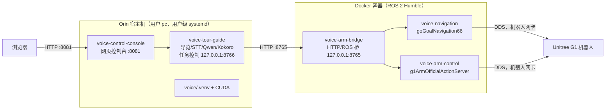
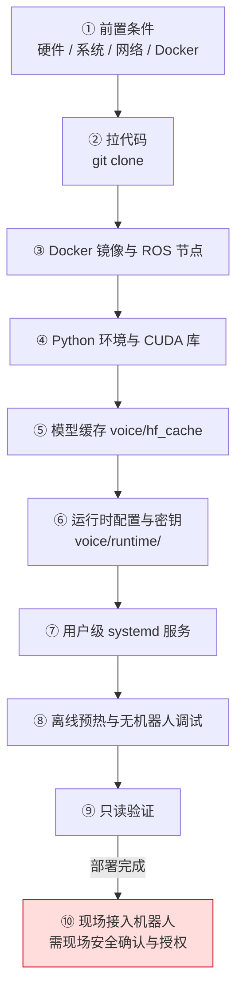

# Orin 部署指南

本文说明如何在一台 Jetson Orin 设备（以现有的 `new-orin` 为参照）上，从 `git clone` 拉代码开始，一直做到“部署完成、通过只读安全检查”，最后再列出现场接入机器人的顺序。

> **只适用于 Orin 的用户级 systemd 路线。** 旧 NX（`/home/unitree/RobotABrainOnline`、系统级 systemd）的部署方式不适用于 Orin，两条路线不要混用；尤其**不要运行 `voice/scripts/install_services.sh`**，它是 NX 系统级安装脚本，末尾会执行 `systemctl enable --now`，直接把服务启动起来。

本文所有命令都来自仓库里的实际脚本或 `HANDOFF_REPORT.md` 记录的 new-orin 实测结果。仓库里查不到的信息一律标为 **未确认**，不要自行补猜。

---

## 0. 先读懂：部署完成后系统是什么样

### 0.1 一句话

Orin 宿主机（Host，指设备本身的操作系统，而不是容器里）上跑网页控制台、语音识别、问答和语音合成；机器人相关的 ROS 节点全部跑在 Docker 容器里；两边通过本机 HTTP 接口说话。

### 0.2 几个必须先知道的基础概念

| 概念 | 白话解释 |
| --- | --- |
| Git 克隆（git clone） | 把 GitHub 上的代码仓库完整复制一份到本机。 |
| Docker 镜像（image）/ 容器（container） | 镜像像一张“装好全部软件的系统光盘”，容器是用这张光盘临时开起来的一台“小电脑”。本项目的 ROS 环境全装在镜像 `unitree_slam_example_new:humble` 里。 |
| ROS 2 Humble | ROS 2（Robot Operating System 2，机器人操作系统框架）的一个发行版本，负责节点之间收发导航目标、手臂动作等消息。 |
| DDS（Data Distribution Service，数据分发服务） | ROS 2 底层用来在网络上传消息的通信协议；本项目用 Fast DDS 实现，必须绑定到“连机器人的那块网卡”。 |
| 网卡（NIC，Network Interface Card） | 设备上的一个网络接口，例如有线口 `eno1`、回环口 `lo`。回环口（loopback）只能和本机自己通信，`127.0.0.1` 就是它的地址。 |
| systemd / 服务单元（unit） | Linux 管理后台服务的系统；每个服务由一个 `.service` 文件（unit）描述“怎么启动、挂了怎么办”。 |
| 用户级 systemd（`systemctl --user`） | 以普通用户身份管理服务，unit 放在 `~/.config/systemd/user/`，不需要 root。Orin 用的就是这种。**所有命令都必须带 `--user`**，不带就会去查系统级服务，结果是“找不到”。 |
| 常驻（Linger） | 让用户级服务在该用户没有登录时也能开机运行的开关。不开的话，SSH 断开或重启后服务就停了。 |
| 虚拟环境（venv，virtual environment） | 给项目单独准备的一套 Python 和第三方库，不污染系统 Python。路径固定为 `voice/.venv`。 |
| CUDA | NVIDIA 显卡/GPU 的计算平台。语音合成模型在 GPU 上跑，依赖 CUDA 动态库。 |
| JetPack | NVIDIA 给 Jetson 系列（含 Orin）出的整套系统包，包含 Ubuntu、驱动和 CUDA；JetPack 版本决定能装哪个版本的 PyTorch。 |
| PyTorch（torch） | 深度学习框架，Kokoro 语音合成依赖它在 GPU 上运行。 |
| STT（Speech-to-Text，语音识别） | 把麦克风声音转成文字；本项目用阿里云 DashScope 的实时识别。 |
| Qwen | 阿里云通义千问大模型，负责回答游客提问，需要联网和 API Key（访问密钥）。 |
| TTS（Text-to-Speech，语音合成） | 把文字合成为语音；本项目用 Kokoro 模型（`hexgrad/Kokoro-82M`，音色 `zm_yunxi`）。 |
| 模型缓存（HF cache） | Kokoro 模型文件从 Hugging Face（一个模型托管网站）下载后存放的目录，本项目固定为 `voice/hf_cache`，运行时强制离线读取。 |
| PulseAudio / ALSA | Linux 的两层音频系统。ALSA（Advanced Linux Sound Architecture）是底层驱动；PulseAudio 是上层“音频服务器”，负责把声音路由到系统默认音响（sink，音频输出端）。 |

### 0.3 部署完成后的运行拓扑



五个服务及其“是否会让机器人动起来”（详见 [PROJECT_GUIDE.md](PROJECT_GUIDE.md) §6）：

| 服务 | 作用 | 会驱动机器人吗 | 部署完成后的预期状态 |
| --- | --- | --- | --- |
| `voice-control-console` | 8081 网页控制台 | 本身不动，但网页按钮能启动下面的运动服务 | active + enabled |
| `voice-arm-bridge` | 宿主与 ROS 之间的 HTTP 桥 | 本身不动，被调用时会转发目标和动作 | active + enabled |
| `voice-navigation` | 导航节点 | **会**：启动即初始化/重定位，收到目标就走 | inactive + disabled |
| `voice-arm-control` | 手臂动作服务 | **会**：收到动作请求就执行 | inactive + disabled |
| `voice-tour-guide` | 常驻预热导览 | 预热本身不走路线；网页“启动导览”后**会** | inactive + disabled |

---

## 1. 整体流程图



| 步骤 | 会驱动机器人吗 | 说明 |
| --- | --- | --- |
| ① ~ ⑨ | 不会 | 只装软件、生成配置、做离线合成和只读检查。⑦ 会启动控制台和桥两个服务，⑧ 的无机器人调试会用到麦克风和音响，但都不连机器人。 |
| ⑩ | **会** | 启动导航、手臂、导览服务，以及网页“启动导览”。**必须在现场确认安全并获得明确授权后才能执行。** |

本文默认路径与账号沿用 new-orin：项目目录 `/mnt/disk1/gt/RobotABrainOnline`，账号 `pc`。换设备时可以换目录，下文所有脚本都会按“脚本自身所在位置”推算项目根目录，不依赖固定路径。下文命令默认都在项目根目录执行。

---

## ① 前置条件

**解决什么问题：** 后面每一步都依赖这些基础环境，缺一个就会在中途失败。

| 项目 | 要求 | 状态 |
| --- | --- | --- |
| 硬件 | Jetson Orin，aarch64（ARM 64 位）架构 | 具体型号 **未确认** |
| JetPack / CUDA 版本 | 需与后面装的 PyTorch 匹配 | **未确认**（仓库只记录了旧 NX 是 JetPack 5.1.1，不能套用到 Orin） |
| 账号 | 普通用户，new-orin 上是 `pc` | 已知 |
| 公网 | 访问 GitHub、pip 源、Docker 镜像仓库、阿里云 DashScope | 必需 |
| Docker | 包含 `docker compose`（Compose V2 插件）；用户 `pc` 不加 `sudo` 就能执行 `docker` | 必需；如何配置的 **未在仓库中记录** |
| sudo 权限 | 开启 Linger、修系统配置时需要 | new-orin 上用户已授权配置了免密 sudo（`/etc/sudoers.d/90-pc-nopasswd`）；新设备是否需要由用户决定 |

**如何验证：**

```bash
uname -m                       # 应输出 aarch64
docker ps                      # 不加 sudo 也不报权限错误
docker compose version         # 能输出版本号
curl -sS -o /dev/null -w '%{http_code}\n' https://dashscope.aliyuncs.com   # 能返回一个 HTTP 状态码即说明网络通
```

**常见失败：**

| 现象 | 原因与处理 |
| --- | --- |
| 有 IP 却上不了公网 | new-orin 踩过：Wi-Fi 连接缺默认网关（gateway）和 DNS（域名解析服务器）。当时是给该连接补齐 `ipv4.gateway`、`ipv4.dns` 后重新应用。改网络前先记下原值，方便回滚。 |
| `docker ps` 报 permission denied | 用户无 Docker 权限。后面的服务全部以用户身份调 `docker compose`，必须先解决。 |
| GitHub / Docker / Hugging Face 超时 | 网络环境问题，需要代理；具体代理方案 **未确认**。 |

---

## ② 拉代码

**解决什么问题：** 把项目代码放到 Orin 上。

```bash
mkdir -p /mnt/disk1/gt
cd /mnt/disk1/gt
git clone https://github.com/firmiana114/RobotABrainOnline.git
cd RobotABrainOnline
```

**如何验证：**

```bash
git status --short             # 无输出表示工作区干净
git rev-parse --short HEAD     # 记下当前提交号
ls voice/scripts/install_user_services.py
```

**要知道的事：** 下列内容被 `.gitignore`（Git 忽略清单）排除，克隆下来**没有**，必须在后面的步骤里自己准备：

| 路径 | 内容 | 在哪一步准备 |
| --- | --- | --- |
| `voice/.venv/` | Python 虚拟环境 | ④ |
| `voice/hf_cache/` | Kokoro 模型缓存 | ⑤ |
| `voice/runtime/` | 密钥、部署配置、日志、派生文件 | ⑥ ⑦ |
| `runtime/` | 根目录的 Fast DDS 生成配置 | 运行脚本时自动生成 |
| `../RobotABrainOnline-runtime/lib` | CUDA 库修补用的旁目录（在仓库外） | ④ |
| `voice/conf/*_route.json`、`voice/guide_qa_context.txt` | 由台词文件派生的路线和问答上下文 | 运行时自动生成 |

`voice/guide_cache/` 里已有一部分预生成语音被提交在 Git 中，缺的会在 ⑧ 预热时补齐。

---

## ③ Docker 镜像与 ROS 节点

**解决什么问题：** 导航、手臂和 HTTP 桥都在容器里运行，需要镜像 `unitree_slam_example_new:humble`。这个镜像已经内置 Unitree SDK2（宇树机器人官方开发包，约 411 MB）、自定义 Action（ROS 2 的“长任务”消息类型）和六个 C++ 节点，所以**有镜像就能跑，不需要在宿主机上编译**。

获取镜像有两条路：

| 方式 | 命令 | 前提 | 状态 |
| --- | --- | --- | --- |
| A. 自己构建 | `UNITREE_SDK2_CONTEXT=/path/to/unitree_sdk2 ./docker/build_image.sh` | 仓库外有一份 `unitree_sdk2` 目录；能拉取基础镜像 `ghcr.io/aaronai/rabbitbot-nav-portable:20260611` | `unitree_sdk2` 从哪获取 **未确认**；基础镜像是否公开可拉 **未确认** |
| B. 从已有设备导入 | 在已有设备导出镜像文件，再在 Orin 导入 | 有一台已装好镜像的设备 | new-orin 当初用哪种方式拿到镜像 **未确认**；仓库没有导出/导入脚本 |

方式 A 的细节：`docker/build_image.sh` 默认找 `/mnt/ssd/navgation/projects/unitree_sdk2`，Orin 上通常没有这个路径，需要用 `UNITREE_SDK2_CONTEXT` 指到实际位置。脚本会先检查这四样东西存在，缺一个就退出：

```text
<sdk>/include
<sdk>/lib/aarch64/libunitree_sdk2.a
<sdk>/thirdparty/lib/aarch64/libddsc.so
<sdk>/thirdparty/lib/aarch64/libddscxx.so
```

**如何验证（只读，不连机器人）：**

```bash
docker image inspect unitree_slam_example_new:humble >/dev/null && echo image-ok
docker run --rm unitree_slam_example_new:humble check
```

`check` 成功时最后一行包含 `embedded runtime check passed nodes=6`，表示 SDK、自定义 Action、六个节点和它们依赖的动态库都完整。

**可选：修改了 C++ 源码才需要重新编译。**

```bash
ROS_INTERFACE=lo ./docker/build_example.sh
```

**常见失败与坑：**

| 现象 | 原因与处理 |
| --- | --- |
| `Missing Unitree SDK build context component` | `UNITREE_SDK2_CONTEXT` 没指对或 SDK 不完整。 |
| `Required image is not available` | 运行 `build_example.sh` 前没有镜像，先完成上面的 A 或 B。 |
| `Unable to resolve IPv4 address for ROS interface: eth0` | `build_example.sh` 会生成 DDS 配置，没指定网卡时自动找 `192.168.123.*` 网段，找不到就用 `eth0`；Orin 上没有 `eth0` 就失败。没连机器人时用 `ROS_INTERFACE=lo`。 |
| 编译后运行的是新编译版本 | 反直觉：一旦 `example/build_docker/` 里有编译产物，运行时会**优先用挂载的编译产物**而不是镜像内置节点。想回到镜像版本需清掉该目录。 |

---

## ④ Python 环境与 CUDA 库

**解决什么问题：** 控制台、导览、语音识别、问答、语音合成都在宿主机的 `voice/.venv` 里运行，所有服务脚本都直接调用 `voice/.venv/bin/python`，这个解释器不存在服务就起不来。

### 4.1 架构硬约束（无论怎么装都必须遵守）

- 宿主 venv **不 source ROS、不 import `rclpy`（ROS 2 的 Python 库）、不装 `custom_action_interfaces`**。所有 ROS 相关内容只在容器里。原因：宿主的 CUDA/PyTorch/Python 版本组合与 ROS 的依赖混在一起容易产生库冲突。
- venv 路径必须是 `voice/.venv`（脚本写死了这个位置）。

### 4.2 venv 和 torch 怎么装：**未确认**

仓库里**没有** Orin 的 Python 环境安装脚本，也没有记录 new-orin 的 Python 版本、torch 版本和安装来源。

仓库里只有 NX 的 `voice/scripts/install_nx_venv.sh`，它写死了 Python 3.8 路径（`lib/python3.8`）和 JetPack 5.1.1 的 torch 安装包地址，**不能直接用于 Orin**。它可以作为“需要装哪些包”的参考：

| 类别 | 包（来自 NX 脚本与 requirements 文件） |
| --- | --- |
| 控制台 | fastapi、uvicorn、pydantic、httpx、pytest（见 `voice/requirements-control-console.txt` / `requirements-nx-console.txt`） |
| 导览 | numpy、scipy、dashscope、openai、soundfile、pyaudio（见 `voice/requirements-nx-tour.txt`） |
| 语音合成 | torch（需与 JetPack 匹配的 NVIDIA 版）、kokoro 0.9.4、misaki 0.9.4 及其语言依赖（spacy 英文模型 en_core_web_sm、jieba、pypinyin、cn2an 等） |

Orin 上该用哪个 requirements 文件、哪个 torch 安装包，**未确认**，需要向维护者确认后再装。

### 4.3 CUDA 库的坑：`libcusparseLt.so.0` 链接错误

new-orin 实测踩过：系统 CUDA 目录里的 `libcusparseLt.so.0` 是一个**错误的符号链接**（symlink，类似快捷方式），指向了 `libcusparse.so`（名字很像但是另一个库），导致 torch 加载失败。

当时的处理方式是**不改系统库**，而是在仓库**旁边**建一个目录放正确的库，再用 `LD_LIBRARY_PATH`（动态库搜索路径环境变量，排在前面的目录优先）让程序先找到它：

```text
/mnt/disk1/gt/RobotABrainOnline           ← 仓库
/mnt/disk1/gt/RobotABrainOnline-runtime/lib  ← 放正确的 libcusparseLt.so.0
```

这个路径不需要手动配置：`install_user_services.py`、`prewarm_offline.sh`、`debug_tour_no_robot.sh` 都默认把 `<仓库路径>-runtime/lib` 加到 `LD_LIBRARY_PATH` 最前面；也可以用环境变量 `VOICE_RUNTIME_LIB` 改成别的目录。

正确的库从哪里取得 **未确认**。

先检查本机是否有同样的问题：

```bash
ls -l /usr/local/cuda/lib64/ | grep -i cusparse
```

如果 `libcusparseLt.so.0` 指向 `libcusparse.so...`，就是同一个坑。

### 4.4 如何验证

```bash
test -x voice/.venv/bin/python && echo venv-ok
LD_LIBRARY_PATH="$PWD-runtime/lib:/usr/local/cuda/lib64" \
  voice/.venv/bin/python -c 'import dashscope, kokoro, misaki, openai, torch; print("cuda=", torch.cuda.is_available())'
voice/.venv/bin/pip check
```

期望：输出 `cuda= True`；`pip check` 报告无冲突（new-orin 实测如此）。

| 现象 | 原因与处理 |
| --- | --- |
| `cuda= False` | torch 不是 NVIDIA Jetson 版或与 JetPack 不匹配。 |
| 导入 torch 时报 `libcusparseLt` 相关错误 | 见 4.3。 |
| 服务日志 `Python is unavailable path=.../voice/.venv/bin/python` | venv 不在 `voice/.venv`。 |

---

## ⑤ 模型缓存 `voice/hf_cache`

**解决什么问题：** 所有服务都以“强制离线”模式运行（`HF_HUB_OFFLINE=1`，即不联网下载模型），所以 Kokoro 模型必须事先放进 `voice/hf_cache`（实际读取 `voice/hf_cache/hub`）。

需要的模型：`hexgrad/Kokoro-82M`，音色 `zm_yunxi`（可用 `KOKORO_REPO_ID`、`KOKORO_VOICE` 覆盖，两者须同时切换）。

**怎么准备：** 仓库没有下载或拷贝模型的脚本，new-orin 上缓存是怎么放进去的 **未确认**。

**如何验证：** 直接用 ⑧ 的离线预热验证——能合成出语音就说明缓存可用。

```bash
test -d voice/hf_cache/hub && echo cache-dir-ok
```

**常见失败：** 预热报找不到模型或尝试联网 → 缓存缺失或不在 `voice/hf_cache/hub` 下。

---

## ⑥ 运行时配置与密钥

**解决什么问题：** 密钥、网卡名、音频设备名因设备而异，不能写进 Git，统一放在 `voice/runtime/`。

这两个文件由下一步 ⑦ 的 `install_user_services.py` **首次运行时自动生成模板**（权限 0600，即只有文件主人能读写），已存在则不覆盖。所以实际顺序是：先跑 ⑦ 的安装脚本，再回来改这两个文件。

| 文件 | 内容 | 模板默认值 |
| --- | --- | --- |
| `voice/runtime/deployment.env` | 机器人网卡 | `ROS_INTERFACE=lo`（只用回环口，即“机器人离线”模式） |
| `voice/runtime/voice.env` | 密钥与语音设备 | `DASHSCOPE_API_KEY=`（空）、`QWEN_MODEL=qwen-plus`、`KOKORO_REPO_ID=hexgrad/Kokoro-82M`、`KOKORO_VOICE=zm_yunxi`、`ALSA_INPUT_DEVICE=plughw:CARD=Rx,DEV=0`、`SPEAKER_NAME=...` |

### 6.1 填密钥

用文本编辑器打开 `voice/runtime/voice.env`，在 `DASHSCOPE_API_KEY=` 后填入阿里云 DashScope 的 Key。**不要用 `cat` 打印这个文件，不要提交到 Git，不要贴到聊天或日志里。**

**如何验证（不泄露内容）：**

```bash
stat -c '%a' voice/runtime/voice.env                        # 应为 600
grep -c '^DASHSCOPE_API_KEY=.\+' voice/runtime/voice.env    # 输出 1 表示已填
```

### 6.2 填音频设备

| 方向 | 说明 | 查看命令 |
| --- | --- | --- |
| 麦克风 | `ALSA_INPUT_DEVICE` 必须与实际麦克风一致（例如 `plughw:CARD=MINI,DEV=0`） | `arecord -l` |
| 音响 | 默认走 PulseAudio 系统默认输出（`aplay -D pulse`），**不再按 `SPEAKER_NAME` 匹配**；需要在系统里把目标音响设为默认 | `pactl list short sinks`，`pactl set-default-sink <sink名>` |

USB 音响只被识别为串口不代表能出声，要在 `pactl list short sinks` 里能看到才算可用。

### 6.3 网卡

部署阶段保持 `ROS_INTERFACE=lo` 不动。连机器人时再改，见 ⑩。

---

## ⑦ 用户级 systemd 服务

**解决什么问题：** 让五个服务能被 systemd 管理、开机自启，并且网页控制台能通过用户级 systemd 管理它们。

### 7.1 生成并安装 unit（不启动任何服务）

```bash
python3 voice/scripts/install_user_services.py
```

这个脚本做了什么：

| 动作 | 说明 |
| --- | --- |
| 改写 unit | 读 `voice/deploy/systemd/*.service`，把 NX 路径替换为当前仓库路径，去掉 `User=unitree`，安装目标改为 `default.target`，`NAV_IFACE` 默认改为 `eno1` |
| 注入环境 | 每个 unit 加上 `LD_LIBRARY_PATH=<仓库>-runtime/lib:/usr/local/cuda/lib64`、`VOICE_SYSTEMCTL_PATH`、空的 `VOICE_CONSOLE_SUDO`（控制台不用 sudo），并读取 `voice/runtime/deployment.env` |
| 写到 | `~/.config/systemd/user/` |
| 生成包装器 | `voice/runtime/systemctl-user`，内容就是 `systemctl --user`，供控制台网页管理用户级服务 |
| 生成模板 | 首次运行时生成 ⑥ 的两个配置文件，已存在则不覆盖 |
| 收尾 | 执行 `systemctl --user daemon-reload`（让 systemd 重新读取 unit），**不启动、不 enable 任何服务** |

成功时输出 `Installed user services. No service was started. Robot NIC default: eno1.`。以后换目录或更新 unit 文件，重跑这条命令即可。

### 7.2 开启 Linger

```bash
sudo loginctl enable-linger pc
loginctl show-user pc -p Linger     # 应输出 Linger=yes
```

`loginctl enable-linger` 是 systemd 的标准命令，仓库里只记录了 new-orin 的结果为 `Linger=yes`。

### 7.3 启用控制台和桥

部署完成后的预期是：控制台与桥 active + enabled，其余三个 inactive + disabled。安装脚本不会 enable，需要操作者执行：

```bash
systemctl --user enable --now voice-control-console voice-arm-bridge
```

> 这一步会**启动**两个服务，但都不驱动机器人：桥在 `ROS_INTERFACE=lo` 下只用回环口，连不到机器人。是否执行由操作者决定。**不要 enable 导航、手臂、导览三个服务。**

**如何验证：**

```bash
systemctl --user is-active voice-control-console voice-arm-bridge    # 都是 active
curl -s http://127.0.0.1:8765/healthz                                # 返回 {"ok": true, "service": "voice-humble-bridge"}
curl -s -o /dev/null -w '%{http_code}\n' http://127.0.0.1:8081/       # 200
journalctl --user -u voice-arm-bridge -n 50                          # 查看日志
```

**常见失败：**

| 现象 | 原因与处理 |
| --- | --- |
| `Unit ... not found` | 命令漏了 `--user`。 |
| SSH 断开后服务停了 | 没开 Linger。 |
| 桥日志 `Unable to resolve IPv4 address for ROS interface` | `deployment.env` 里的网卡不存在或没 IP。 |
| 桥起不来、docker 权限错误 | 用户不能直接用 Docker，见 ①。 |

---

## ⑧ 离线预热与无机器人调试

### 8.1 离线预热（不需要 Key，不连机器人）

**解决什么问题：** 一次性把正式路线 `voice/conf/dialogue_0.json` 的所有台词合成为语音缓存，同时验证 venv、CUDA 库、模型缓存三者能协同工作。

```bash
voice/scripts/prewarm_offline.sh
```

它只做语音合成：不创建云端客户端、不录音、不播放、不调用机器人。还会额外强制合成一句“离线语音部署验证。”作为探针，确保真的跑了一次 GPU 推理而不是全部命中缓存。

**如何验证：** 最后一行输出一行 JSON，字段为 `cuda`（应为 true）、`segments`（台词段数）、`generated`（本次新合成段数）、`audio_seconds`（总时长）。new-orin 实测为 34 段台词、总时长约 496 秒（约 8 分钟）。每段都会校验能读取、采样率为 24000 Hz、数据没有异常值。派生路线和探针文件写在 `voice/runtime/`，不进 Git。

| 现象 | 原因与处理 |
| --- | --- |
| `CUDA unavailable` | torch 或 CUDA 库问题，回到 ④。 |
| 模型加载失败 | 模型缓存问题，回到 ⑤。 |

### 8.2 无机器人语音调试（需要 Key 和网络，会用麦克风和音响，不连机器人）

**解决什么问题：** 在机器人不在线时，用真实麦克风、真实云端识别和问答、真实外放走一遍导览流程，导航和手臂用进程内模拟代替（手臂请求只打印 `[SIMULATION]`）。详细用法见 [voice/DEBUG_NO_ROBOT.md](voice/DEBUG_NO_ROBOT.md)。

```bash
voice/scripts/debug_tour_no_robot.sh --check    # 只检查配置和音频设备，然后退出
voice/scripts/debug_tour_no_robot.sh            # 跑第一个路线项；说“小智，……”可打断提问；Ctrl+C 停止
```

注意：调试默认麦克风是 DJI MIC MINI（`plughw:CARD=MINI,DEV=0`），可用 `--mic` 指定别的；**不要和正式导览服务同时运行**，会争抢麦克风。

**如何验证：** `--check` 正常退出；完整运行能听到播报、能被“小智”打断并回答。`--check` 只证明设备能打开，不证明现场听得见。

---

## ⑨ 只读验证（部署完成的判定）

**解决什么问题：** 用一组**不改变任何状态**的命令确认部署完成。以下命令都不会启动服务、不会驱动机器人。

```bash
cd /mnt/disk1/gt/RobotABrainOnline

# 代码
git status --short
git rev-parse --short HEAD

# 服务状态（必须带 --user）
systemctl --user is-enabled voice-control-console voice-arm-bridge voice-navigation voice-arm-control voice-tour-guide
systemctl --user is-active  voice-control-console voice-arm-bridge voice-navigation voice-arm-control voice-tour-guide
loginctl show-user pc -p Linger

# 运行文件（不输出密钥内容）
test -x voice/.venv/bin/python && echo venv-ok
stat -c '%a' voice/runtime/voice.env
test -d voice/hf_cache && echo cache-ok
docker image inspect unitree_slam_example_new:humble >/dev/null && echo image-ok
docker run --rm unitree_slam_example_new:humble check

# 本机接口（只用 GET 读取）
curl -s http://127.0.0.1:8765/healthz
curl -s http://127.0.0.1:8765/nav_state
curl -s -o /dev/null -w '%{http_code}\n' http://127.0.0.1:8081/

# 单元测试（需要 venv 里装了 pytest）
voice/.venv/bin/python -m pytest -q voice/tests
```

**通过标准：**

| 检查项 | 期望结果 |
| --- | --- |
| is-enabled | 控制台、桥为 `enabled`；导航、手臂、导览为 `disabled` |
| is-active | 控制台、桥为 `active`；其余为 `inactive` |
| Linger | `Linger=yes` |
| voice.env 权限 | `600` |
| 镜像 check | `embedded runtime check passed nodes=6` |
| `/healthz` | `"ok": true` |
| `/nav_state` | `goal_subscribers` 为 0（导航没启动，与机器人离线一致） |
| 控制台首页 | `200` |
| pytest | 全部通过（new-orin 当时为 77 项） |

`curl http://127.0.0.1:8766/status` 此时连不上是正常的，因为导览服务还没启动。

**重要：** 只读验证通过只代表“软件部署完成”，**不代表机器人在线，也不代表导览就绪**。此时不要在网页上点“重启导览服务”或启动导航、手臂相关按钮。

---

## ⑩ 现场接入机器人（会驱动机器人）

> ⚠️ **以下第 3 步起会让机器人运动。必须在现场确认周围安全、有人监护并获得明确授权后，才能执行。** 截至 2026-10-21，new-orin 上这些步骤都**尚未执行过**。

| 顺序 | 操作 | 驱动机器人吗 |
| --- | --- | --- |
| 1 | 确认 ⑥ 的 Key 已填、音频设备名与实际一致 | 不会 |
| 2 | 确认机器人连在哪块网卡、该网卡已有 IP 后，在 `voice/runtime/deployment.env` 里把 `ROS_INTERFACE` 和 `NAV_IFACE` **都**设为该网卡（例如都为 `eno1`）；再 `systemctl --user restart voice-arm-bridge` 并检查 `curl -s http://127.0.0.1:8765/healthz` | 不会 |
| 3 | `systemctl --user start voice-navigation`，看状态和日志 | **会**（启动即初始化/重定位） |
| 4 | `systemctl --user start voice-arm-control`，看状态和日志 | **会**（收到请求即动作） |
| 5 | `systemctl --user start voice-tour-guide`，等待预热；`curl -s http://127.0.0.1:8766/status` 必须显示真实预热就绪 | 预热本身不走路线 |
| 6 | 通过网页 `http://<Orin-IP>:8081` 手动启动导览 | **会** |

每一步都用 `systemctl --user status <服务>` 和 `journalctl --user -u <服务> -n 50` 检查后再进行下一步。

**这一段的坑（反直觉，最容易出错）：**

| 坑 | 说明 |
| --- | --- |
| 两个网卡变量必须一起改 | 桥用 `ROS_INTERFACE`，导航和手臂用 `NAV_IFACE`；但导航/手臂启动脚本生成 DDS 配置时会**优先读 `ROS_INTERFACE`**。如果只改了 `NAV_IFACE`、`ROS_INTERFACE` 还是 `lo`，导航的 DDS 会绑在回环口上，连不到机器人。 |
| `deployment.env` 不会配置网卡 | 它只告诉程序用哪块网卡，网卡本身的 IP、路由要另外配好。new-orin 部署时 `eno1` 无链路，未改过 IP 或路由。 |
| 导览服务离线时启动必失败 | 导览预热会检查导航节点是否在接收目标（`/go_goal_pose` 订阅者），没有就直接失败；这是设计如此，不要绕过。 |
| 改了台词、模型或音色后 | 需要重启导览服务重新预热，否则新台词会在导览时临时合成。 |

---

## 附录 A：名词速查表

| 名词 | 解释 |
| --- | --- |
| aarch64 | ARM 64 位 CPU 架构，Jetson 设备使用。 |
| CUDA | NVIDIA GPU 计算平台。 |
| DashScope | 阿里云的大模型服务平台，提供 STT 和 Qwen。 |
| DDS / Fast DDS | ROS 2 底层网络通信协议及其一种实现。 |
| Docker 镜像 / 容器 | 打包好的运行环境 / 由镜像启动的隔离运行实例。 |
| JetPack | NVIDIA Jetson 的系统软件包，决定 CUDA 和可用的 PyTorch 版本。 |
| `LD_LIBRARY_PATH` | 程序加载动态库时优先搜索的目录列表。 |
| Linger | 让用户级服务在用户未登录时也运行的开关。 |
| PulseAudio / ALSA / sink | 上层音频服务器 / 底层音频驱动 / 音频输出端。 |
| Qwen | 通义千问大模型，负责问答。 |
| ROS 2 Humble | 机器人操作系统框架的一个版本。 |
| STT / TTS | 语音识别 / 语音合成。 |
| systemd / unit / `--user` | Linux 服务管理器 / 服务描述文件 / 用户级模式。 |
| venv | Python 虚拟环境。 |
| 回环口 `lo` | 只能与本机通信的虚拟网卡，地址 `127.0.0.1`。 |
| 符号链接（symlink） | 指向另一个文件的“快捷方式”。 |
| 预热 | 提前加载模型、合成整条路线语音，让正式导览启动时不用等待。 |

## 附录 B：待确认清单

以下信息仓库中查不到，部署新设备前需要向维护者确认：

1. Orin 的具体型号与 JetPack / CUDA 版本。
2. Orin 上 Python 版本、venv 创建方式、torch 安装包来源及版本、应使用的 requirements 文件。
3. 正确的 `libcusparseLt.so.0` 从哪里获取。
4. `unitree_sdk2` 的获取渠道；基础镜像 `ghcr.io/aaronai/rabbitbot-nav-portable:20260611` 是否可公开拉取；或 new-orin 镜像的导入方式。
5. Kokoro 模型缓存 `voice/hf_cache` 的准备方式。
6. 用户 Docker 权限的配置方式。
7. 网络受限时使用的代理方案。

## 相关文档

- [README.md](README.md)：部署完成后的正式导览启动说明（以 NX 为例）。
- [PROJECT_GUIDE.md](PROJECT_GUIDE.md)：架构、服务、配置项和诊断的完整说明。
- [voice/DEBUG_NO_ROBOT.md](voice/DEBUG_NO_ROBOT.md)：无机器人语音调试。
- [HANDOFF_REPORT.md](HANDOFF_REPORT.md)：new-orin 部署实测记录与当前状态。
