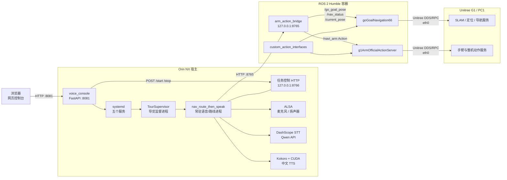
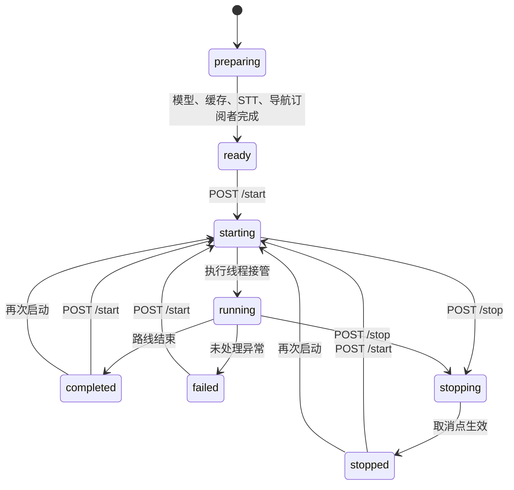

# RobotABrainOnline 项目逻辑与接手指南

## 1. 文档目的

本文面向第一次接触 RobotABrainOnline 的开发、运维和现场调试人员，目标是回答以下问题：

- 这个项目解决什么问题，真正运行在哪里？
- 网页、语音、ROS 2、Unitree SDK 和机器人之间如何协作？
- 五个 systemd 服务各自负责什么，为什么必须按顺序启动？
- 一次完整导览从“点击启动”到“导航、动作、播报、问答”经历哪些状态？
- 导览配置如何生成运行路线和问答上下文？
- 修改不同模块时，应查看哪些文件、运行哪些验证？
- 哪些操作会让真实机器人运动，哪些安全限制不能绕过？

根目录 `README.md` 是现场启动手册，`HANDOFF_REPORT.md` 是近期状态与历史验证记录；本文侧重长期有效的系统逻辑和代码导航。

## 2. 一句话理解项目

RobotABrainOnline 是一套运行在 NVIDIA Jetson Orin NX 上的 Unitree G1 在线导览系统：

- NX 宿主负责网页控制、导览编排、麦克风采音、阿里云语音识别、Qwen 问答、Kokoro 语音合成和扬声器播放。
- ROS 2 Humble 容器负责导航话题、自定义 Action 和 Unitree SDK 调用。
- 机器人 PC1 负责实际 SLAM、定位、导航和机器人底层执行。

项目刻意用本机 HTTP 桥隔离“宿主 Python 语音环境”和“容器 ROS 2 Humble 环境”，避免在 NX 宿主 venv 中混装 `rclpy`、ROS 2 Foxy/Humble 或自定义 Action。

## 3. 安全边界

本项目能够发送真实导航目标和手臂动作。阅读和调试时必须先区分“只读操作”和“会驱动机器人运动的操作”。

### 3.1 不会主动驱动机器人运动的典型操作

- 阅读代码和配置。
- 运行纯 Python 单元测试。
- 运行 Python 静态编译和 Shell 语法检查。
- 生成或校验 `dialogue_0_route.json`、`guide_qa_context.txt`。
- 查询 systemd、Docker、ROS 话题或 HTTP 健康状态。
- 启动网页控制台本身。
- 在不启动导览任务的前提下完成 Kokoro 模型和路线音频预热。

### 3.2 可能驱动机器人运动的操作

- 启动导航节点时启用自动重定位。
- 向 `/go_goal_pose` 发布目标。
- 调用 HTTP `POST /goal`。
- 启动正式导览任务。
- 调用 `/navi_arm` Action 或 HTTP `POST /navi_arm`。
- 直接运行 `keyDemo`、导航 Action 或 Unitree 手臂示例。

### 3.3 必须牢记的限制

- 软件“停止导览”只能阻止后续步骤，并尝试停止当前音频；它不能撤回已经交给导航节点的目标。
- 手臂 HTTP 桥返回成功，表示 ROS Action Goal 已被服务端接受，不表示动作已经执行完毕。
- 发生现场风险时必须优先使用机器人急停，不能等待 Python、systemd 或 ROS 正常退出。
- 未经现场安全确认和明确授权，不应启动、重启或测试导航、手臂和正式导览。
- API Key、令牌、完整识别文本、大段问题或原始音频不得写入日志或提交 Git。

## 4. 系统部署拓扑



### 4.1 三个运行环境

| 环境 | 主要职责 | 关键技术 | 不应承担的职责 |
| --- | --- | --- | --- |
| NX 宿主 | 网页、服务管理、导览编排、STT、Qwen、TTS、音频 | Python 3.8 venv、FastAPI、DashScope、OpenAI 兼容 API、Kokoro、PyTorch CUDA、ALSA | 不 source ROS 2 Foxy/Humble，不直接 import `rclpy` |
| Humble 容器 | ROS 2 话题、Action、Unitree SDK2 节点 | Ubuntu 22.04、ROS 2 Humble、Python 3.10、C++17、Fast DDS | 不运行 Kokoro、Qwen 或宿主音频设备编排 |
| 机器人 PC1 | 实际 SLAM 地图解析、定位、导航、运动执行 | Unitree 机器人服务 | 不读取 NX 本地 Git 工作区 |

### 4.2 为什么需要 HTTP 桥

宿主语音环境和 ROS 环境的依赖组合不同：

- NX 宿主依赖 JetPack 5.1.1 对应的 CUDA/PyTorch 和 Python 3.8。
- ROS 节点依赖 Humble、`rclpy`、`custom_action_interfaces` 和 Unitree SDK2。
- 混合 source Foxy/Humble 或把 ROS Python 包安装进宿主 venv，容易产生 ABI、Python 版本和动态库冲突。

因此 `voice/arm_action_bridge.py` 只在 Humble 容器中运行，在回环地址提供窄接口：

- 宿主发送普通 JSON。
- 桥负责转换成 ROS 2 消息或 Action Goal。
- 桥缓存导航状态和位姿，再以 JSON 返回给宿主。

`8765` 和 `8766` 默认都只监听 `127.0.0.1`，不应直接暴露给外部网络。

## 5. 目录结构与模块职责

```text
.
├── README.md
├── PROJECT_GUIDE.md
├── HANDOFF_REPORT.md
├── docker-compose.yml
├── docker/
│   ├── Dockerfile
│   ├── entrypoint.sh
│   ├── build_image.sh
│   ├── build_example.sh
│   ├── run_example.sh
│   └── configure_fastdds.sh
├── custom_action_ws/
│   └── src/custom_action_interfaces/
│       ├── action/
│       ├── scripts/
│       ├── CMakeLists.txt
│       └── package.xml
├── example/
│   ├── CMakeLists.txt
│   ├── include/
│   └── src/
└── voice/
    ├── conf/
    ├── deploy/
    ├── scripts/
    ├── tests/
    ├── voice_console/
    ├── arm_action_bridge.py
    ├── nav_route_then_speak.py
    ├── tour_guide_xiaozhi_interrupt_resume.py
    └── docker-compose.bridge.yml
```

### 5.1 根目录文档

| 文件 | 用途 |
| --- | --- |
| `README.md` | NX 正式导览的启动、停止、状态和常见故障 |
| `PROJECT_GUIDE.md` | 项目架构、核心逻辑、数据流和开发接手指南 |
| `HANDOFF_REPORT.md` | 部署现状、近期修复、已验证事实和剩余阻塞 |

### 5.2 `voice/`

这是正式在线导览的主要业务目录。

| 文件或目录 | 职责 |
| --- | --- |
| `voice/voice_console/app.py` | FastAPI 控制台、内嵌前端页面和 REST API |
| `voice/voice_console/config.py` | 环境变量到运行配置的统一映射 |
| `voice/voice_console/commands.py` | systemd 状态查询、启停前置检查和导览控制转发 |
| `voice/voice_console/dialogue.py` | 导览配置校验、派生文件生成、原子保存和备份 |
| `voice/voice_console/pose.py` | 从 HTTP 桥轮询位姿并判断新鲜度 |
| `voice/voice_console/supervisor.py` | 拉起常驻导览子进程、解析输出并维护状态文件 |
| `voice/voice_console/tour_control.py` | 导览任务状态机和 `8766` 控制接口 |
| `voice/voice_console/interrupt.py` | 音频播放、打断归属、问题收集和异常降级 |
| `voice/voice_console/post_wait_runner.py` | 为台词段注入可取消的 `post_wait_seconds` 等待 |
| `voice/nav_route_then_speak.py` | 路线执行、HTTP 导航、STT、问答和播报编排 |
| `voice/tour_guide_xiaozhi_interrupt_resume.py` | Kokoro、Qwen、基础 STT/TTS 和音频实现 |
| `voice/arm_action_bridge.py` | Humble 容器中的 HTTP/ROS 桥 |
| `voice/conf/dialogue_*.json` | 可在控制台切换、编辑和激活的导览源配置 |
| `voice/conf/*_route.json` | 从所选源配置生成的运行路线，不纳入 Git |
| `voice/conf/*_qa_context.txt`、`voice/guide_qa_context.txt` | 从所选源配置生成的 Qwen 导览知识上下文，不纳入 Git |
| `voice/guide_cache/` | 已生成的路线 WAV；新运行时文件默认忽略 |
| `voice/runtime/` | 状态、私密配置和运行文件，不纳入 Git |
| `voice/deploy/systemd/` | 五个 systemd unit 模板 |
| `voice/scripts/` | 服务启动、环境安装和 systemd 安装脚本 |
| `voice/tests/` | 不依赖真实机器人运动的 Python 测试 |

`voice/aliyun_*`、`voice/test_*` 和 `voice/run_test_*` 主要是独立验证或早期实验入口，不是正式 systemd 主链路。

### 5.3 `example/`

这是 ROS 2 Humble 下编译的 C++ 节点目录。

| 目标 | 源码 | 正式链路用途 |
| --- | --- | --- |
| `keyDemo` | `example/src/keyDemo.cpp` | 键盘式建图/重定位工具，不属于正式导览 |
| `goGoalNavigation` | `example/src/goGoalNavigation_ros2.cpp` | 旧的完整导航实现，会处理 FSM 和子进程 |
| `goGoalNavigation66` | `example/src/goGoalNavigation_ros2_66.cpp` | 正式导航节点；不切 FSM、不托管手臂子进程 |
| `gestureTopicBridge` | `example/src/gesture_topic_bridge.cpp` | ROS 手势命令到 Inspire DDS 的桥 |
| `g1Arm7DIYActionExample` | `example/src/g1_arm7__diy_action_example.cpp` | 自定义关节轨迹 Action Server |
| `g1ArmOfficialActionServer` | `example/src/g1_arm_official_action_server.cpp` | 正式手臂 Action Server，调用 Unitree 官方动作 |

`example/CMakeLists.txt` 是当前构建事实来源。`example/README.md` 包含部分历史目标描述，若与 CMake 或源码冲突，应以 CMake 和 systemd 启动脚本为准。

### 5.4 `custom_action_ws/`

该 ROS 2 包定义九种 Action：

- `NaviForward`
- `NaviRotate`
- `NaviWayPoint`
- `NaviHead`
- `NaviArm`
- `NaviIkArm`
- `NaviGrab`
- `NaviTargetChanged`
- `NaviShakeHands`

正式语音链路主要使用：

- `NaviArm`：HTTP 桥到官方手臂服务。
- `NaviForward`、`NaviRotate`、`NaviWayPoint`：由导航节点提供给其他 ROS 客户端。

`custom_action_ws/src/custom_action_interfaces/scripts/` 中部分 Kuavo、ROS1/Foxy 示例属于历史来源，不是当前 G1 正式导览入口。

## 6. 五个 systemd 服务

### 6.1 服务职责

| 服务 | 进程和职责 | 是否直接导致运动 |
| --- | --- | --- |
| `voice-control-console.service` | 启动 FastAPI 控制台，监听 `0.0.0.0:8081` | 本身不运动，但 API 可重启运动服务 |
| `voice-arm-bridge.service` | 启动 Humble HTTP/ROS 桥，监听 `127.0.0.1:8765` | 接口被调用时可能转发动作或目标 |
| `voice-navigation.service` | 容器内运行 `goGoalNavigation66 eth0 <map>` | 会初始化/重定位；收到目标后导航 |
| `voice-arm-control.service` | 容器内运行 `g1ArmOfficialActionServer eth0` | 收到 Action Goal 后执行动作 |
| `voice-tour-guide.service` | 常驻监督进程、语音模型、STT、路线缓存和任务控制 | 服务预热不走路线；`/start` 后会运动 |

### 6.2 依赖关系

- 导览服务 `Requires=voice-arm-bridge.service`，所以启动导览服务会要求 HTTP/ROS 桥存在。
- 导览服务只对导航和手臂服务声明 `After=`，不会自动启动它们。
- 控制台在重启导览服务和启动导览任务前，会检查导航、手臂是否已由 systemd 或已知外部进程运行。
- 导览进程预热时还会检查 `/go_goal_pose` 是否存在订阅者；没有订阅者会直接失败。

### 6.3 为什么“重启导览服务”和“启动导览”是两个动作

旧模型每次导览都新建进程，会重复支付模型冷启动成本。当前实现拆成两层生命周期：

1. `systemctl restart voice-tour-guide.service`
   - 启动 Python 监督进程。
   - 加载 Kokoro、CUDA 和音色。
   - 预生成整条路线 WAV。
   - 启动 STT。
   - 确认导航订阅者存在。
   - 在 `127.0.0.1:8766` 进入 `ready`。
   - 此阶段不会主动执行路线。

2. `POST http://127.0.0.1:8766/start`
   - 复用已加载的模型、STT 和缓存。
   - 重新读取路线和问答上下文。
   - 从第一个路线节点开始真实导览。

修改台词后，控制台会重新生成路线；如果新增台词没有缓存，任务期间仍能临时合成，但正式使用前应重启导览服务完成整条路线预热。

## 7. 控制台逻辑

### 7.1 启动

`voice/scripts/start_console.sh`：

1. 解析 `VOICE_PROJECT_ROOT` 和 `VOICE_VENV_ROOT`。
2. 确认 `voice/.venv/bin/python` 可执行。
3. 设置 `PYTHONPATH` 和 `POSE_BRIDGE_URL`。
4. 运行 `python -m voice_console`。

`voice/voice_console/__main__.py` 使用 Uvicorn 启动 FastAPI：

- 默认主机：`0.0.0.0`
- 默认端口：`8081`
- 默认启用访问日志

### 7.2 页面生命周期

FastAPI lifespan 启动时：

1. 启动 `PoseTracker` 后台轮询。
2. 校验 `dialogue_0.json`。
3. 重新生成 `dialogue_0_route.json` 和 `guide_qa_context.txt`。

页面每秒读取 `/api/status`，显示：

- 导航、手臂和导览 systemd 状态。
- 是否存在 systemd 之外的同名进程。
- 当前位姿及新鲜度。
- 导览任务状态、当前站点、下一站点和进度。
- 当前地图路径。
- 语音状态。

### 7.3 systemd 操作保护

`SystemdManager` 的主要保护逻辑：

- 查询使用 `systemctl is-active`。
- 服务处于 `failed` 时先执行 `reset-failed`。
- 重启 inactive 服务前，检查并清理精确匹配的外部进程，避免重复实例。
- 导览启动前同时检查导航和手臂前置条件。
- systemd 命令有超时和上下文日志。
- 控制台使用 `sudo -n`，不会等待交互式密码。

`voice/deploy/voice-control-console.sudoers` 只允许 `unitree` 用户对指定的导航、手臂和导览 unit 执行有限的 `start`、`restart`、`reset-failed`。

控制台目前没有应用层身份认证。因为页面能间接重启真实机器人相关服务，部署网络必须可信，并应通过防火墙、反向代理认证或其他访问控制限制 `8081`。

## 8. 导览配置与派生数据

### 8.1 选定台词文件是事实来源

控制台会列出 `voice/conf/` 下除 `*_route.json` 外的台词 JSON；当前选择记录在 `voice/runtime/active_dialogue.json`。不要把任何 `*_route.json` 或 `*_qa_context.txt` 当作编辑入口，因为它们会在以下场景被覆盖：

- 控制台启动。
- 保存台词或点位。
- 重启导览服务前。
- 启动导览任务前。
- 手动运行 `python -m voice_console.generate`。

### 8.2 顶层结构

```json
{
  "variables": {
    "leader_calling": "各位领导"
  },
  "opening": {
    "handshake_greeting": "{leader_calling}您好，我叫小智。"
  },
  "steps": [
    {
      "scene": "点位2",
      "entity_key": "point_2",
      "segments": [
        {
          "text": "点位讲解。",
          "action": "face_wave",
          "speak_with_action": true,
          "post_wait_seconds": 2
        }
      ]
    }
  ],
  "map_file": "test7.pcd",
  "points": {
    "point_2": {
      "name": "点位2",
      "location": [
        {
          "x": 1.0,
          "y": 2.0,
          "z": 0.0,
          "ox": 0.0,
          "oy": 0.0,
          "oz": 0.0,
          "ow": 1.0,
          "mode": 1
        }
      ]
    }
  }
}
```

### 8.3 关键字段

| 字段 | 含义 |
| --- | --- |
| `variables` | 文本变量，目前主要是 `leader_calling` |
| `opening` | 开场台词；按代码中的固定顺序生成，并绑定部分动作 |
| `steps` | 业务顺序、场景名和每个点位的台词段 |
| `entity_key` | `steps` 与 `points` 的关联键 |
| `points.*.location[0]` | 当前真正使用的导航目标 |
| `map_file` | 地图文件名或绝对路径 |
| `segments[].text` | 要播报的文本 |
| `segments[].action` | 台词前发送的官方动作名 |
| `segments[].speak_with_action` | 为真时在播报前触发动作 |
| `segments[].post_wait_seconds` | 本段播报后等待 0–3600 秒 |
| `goal.speed` / `location[].speed` | 可选导航速度 |

坐标必须包含：

- 位置：`x`、`y`、`z`
- 四元数：`ox`、`oy`、`oz`、`ow`
- 模式：`mode`

### 8.4 路线生成规则

`build_route()` 的主要规则：

1. 用 `variables` 替换 `{变量名}`。
2. 把 `opening` 转成一个 `skip_navigation=true` 的开场节点。
3. `point_1` 不再单独生成路线节点。
4. 按 `steps` 原顺序查找对应 `points[entity_key]`。
5. 缺少坐标的步骤不会生成运行节点。
6. 每个节点使用 `location[0]` 作为目标。
7. 空台词节点仍可作为纯导航过渡点。

当前 `dialogue_0.json` 生成：

- 18 个路线节点。
- 17 个需要导航的节点和 1 个跳过导航的开场节点。
- 33 段有效台词。
- 5 次动作触发。
- 点位 8 的宣传片台词及 277 秒等待已移除。
- 地图名为 `test7.pcd`，默认解析为 `/home/unitree/test7.pcd`。

### 8.5 地图路径的真实含义

地图路径由 `VOICE_MAP_ROOT` 和 `map_file` 组合。默认结果是 `/home/unitree/test7.pcd`。

这个路径会作为字符串传给 Unitree SLAM RPC，最终由机器人 PC1 上的 SLAM 服务解析。它不要求同名文件存在于 NX 宿主或 Docker 容器中，因此不要仅凭 NX 上 `test -f` 失败就判断地图不可用。

### 8.6 保存、备份和一致性

`DialogueStore`：

- 使用 `RLock` 串行化同进程编辑。
- 保存前完整校验 JSON、点位、坐标和等待时间。
- 使用同目录临时文件、`fsync` 和 `os.replace` 原子替换。
- 保存源配置时，同时生成路线和问答上下文。
- 保存失败时记录文件路径和异常链。
- 保留有限数量的时间戳 `.bak` 备份。

网页“点位台词热更新”使用空行拆分台词段。等待指令格式必须单独成行：

```text
这是一段台词。
{"post_wait_seconds":277}
```

## 9. 导览服务预热逻辑

### 9.1 监督进程

`voice-tour-guide.service` 先执行 `voice/scripts/start_tour.sh`：

1. 检查 venv Python。
2. 安全加载 `voice/runtime/voice.env`。
3. 设置桥地址、Hugging Face 缓存和离线模式。
4. 要求存在 `DASHSCOPE_API_KEY` 或 `OPENAI_API_KEY`。
5. 启动 `python -m voice_console.supervisor`。

`TourSupervisor` 再启动实际导览子进程：

```text
python -m voice_console.post_wait_runner
  --navigation-script voice/nav_route_then_speak.py
  --standby-control
  --control-host 127.0.0.1
  --control-port 8766
  ...
```

监督进程的职责不是执行路线算法，而是：

- 生成运行文件。
- 构造并启动子进程。
- 解析子进程的结构化输出。
- 将状态原子写入 `voice/runtime/tour_status.json`。
- 对语音内容做日志脱敏。
- 收到 systemd 停止信号时终止整个子进程组。

### 9.2 预热阶段

`nav_route_then_speak.main()` 按顺序完成：

1. 读取并校验路线和动作别名。
2. 读取 Qwen 导览上下文。
3. 创建 `TourGuideAssistant`。
4. 加载 Kokoro 模型到指定设备，默认 CUDA。
5. 对整条路线的每个有效台词计算缓存键并生成缺失 WAV。
6. 启动 `arecord` 和 DashScope 实时 STT；失败时降级为仅播报。
7. 创建 HTTP `RouteNode`。
8. 等待桥报告 `/go_goal_pose` 存在订阅者。
9. 启动 `127.0.0.1:8766` 控制服务。
10. 状态进入 `ready`。

对应日志阶段：

- `[startup] voice_ready`
- `[startup] guide_cache_ready`
- `[startup] stt_ready`
- `[startup] nav_subscriber_ready`
- `[control] ready`

### 9.3 任务状态机



状态文件用于展示，不是跨进程锁。真正的状态同步由 `TourTaskController` 的锁和 Event 完成：

- `start_event`：通知常驻主循环开始新任务。
- `cancel_event`：让导航等待、台词循环和 post-wait 尽快退出。
- `shutdown_event`：关闭整个常驻服务。

## 10. 一次完整路线的执行逻辑

### 10.1 启动任务

网页点击“启动导览”时：

1. 控制台重新生成路线和问答上下文。
2. `SystemdManager` 确认导航、手臂和导览服务就绪。
3. 控制台向 `127.0.0.1:8766/start` 发送 POST。
4. `TourTaskController` 从 `ready/stopped/completed/failed` 进入 `starting`。
5. 常驻主循环收到 `start_event`，进入 `running`。
6. 重新读取路线和问答上下文。

### 10.2 单个路线节点

对每个路线节点：

1. 检查 `cancel_event`。
2. 输出 `[route] 当前序号/总数 -> 点位名`。
3. 如果 `skip_navigation=true`，直接进入台词。
4. 否则标准化目标坐标。
5. 通过 HTTP 桥读取当前导航序列号。
6. `POST /goal` 发布 ROS `/go_goal_pose`。
7. 轮询 `/nav_state`，等待本次目标对应的 `navigating` 后再等待更新的 `arrived` 或 `mid_arrived`。
8. 逐段执行动作、播报和播报后等待。

序列号判断很重要：它避免上一个目标遗留的 `arrived` 被误当作当前目标完成。当前目标只有满足以下顺序才算到达：

```text
goal 发布前的 status_seq
    < 本次 navigating_seq
    < 本次 arrived_seq
```

收到比本次目标更新的 `failed_seq` 会立即报导航失败。

### 10.3 导航超时和取消

- 默认等待导航订阅者 20 秒。
- 默认单点导航超时 180 秒。
- 等待期间每 0.1 秒轮询桥状态。
- `cancel_event` 置位时退出 Python 等待，但不会向导航节点发送撤销目标。
- 导航节点自身仍可能继续前往已经收到的目标。

### 10.4 过渡点

`goGoalNavigation66` 用三个硬编码坐标识别特殊过渡点，允许约 0.05 米误差。到达时发布 `mid_arrived`，其他目标发布 `arrived`。

这是一项代码层业务规则，而不是由路线中的显式 `is_transition` 字段决定。修改过渡点坐标时，必须同步检查 `isMidTransitionPoint()`，否则运行语义可能改变。

## 11. ROS 2 导航逻辑

### 11.1 正式节点

正式服务运行：

```text
goGoalNavigation66 eth0 /home/unitree/test7.pcd
```

`goGoalNavigation66` 是简化版本：

- 不切换 G1 FSM。
- 不在导航进程内拉起或停止手臂进程。
- 保留重定位、目标导航、位姿、SLAM 命令和导航 Action。

手臂进程由独立 systemd 服务管理，这也是正式部署选择 `66` 版本的原因。

### 11.2 ROS 接口

| 类型 | 名称 | 消息 | 用途 |
| --- | --- | --- | --- |
| 订阅 | `/go_goal_pose` | `std_msgs/msg/String` | JSON 导航目标 |
| 订阅 | `/slam_cmd` | `std_msgs/msg/String` | 建图、重定位、暂停、恢复、停止 |
| 发布 | `/nav_status` | `std_msgs/msg/String` | `navigating`、`arrived`、`mid_arrived` 等 |
| 发布 | `/current_pose` | `std_msgs/msg/String` | JSON 位姿 |
| 发布 | `/lio_pose` | `geometry_msgs/msg/PoseStamped` | 高层定位位姿 |
| 发布 | `/kuavo_navigation_state` | `std_msgs/msg/UInt8` | 兼容导航状态 |
| Action | `navi_forward` | `NaviForward` | 相对前进 |
| Action | `navi_rotate` | `NaviRotate` | 相对旋转 |
| Action | `navi_way_point` | `NaviWayPoint` | 目标点导航 |

### 11.3 Unitree SLAM API

导航节点注册并调用的主要 API ID：

| API ID | 用途 |
| --- | --- |
| `1102` | 目标位姿导航 |
| `1201` | 暂停导航 |
| `1202` | 恢复导航 |
| `1801` | 开始建图 |
| `1802` | 结束建图 |
| `1804` | 开始重定位 |
| `1901` | 停止节点 |
| `1008` | 摇杆/运动控制 |

启动时如果提供地图路径，节点会开始自动重定位。只有收到有效位姿后才接受目标导航。

位姿定时器目前每 10 秒发布一次 `/current_pose`；控制台把超过 `VOICE_POSE_STALE_SECONDS`，默认 5 秒的位姿视为过期。因此页面可能周期性显示“位姿已过期”，这是两个默认周期不一致造成的表现，定位逻辑仍需结合导航日志判断。

## 12. HTTP/ROS 桥

### 12.1 启动方式

`voice-arm-bridge.service` 执行：

1. 根据 `ROS_INTERFACE`，默认 `eth0`，获取 IPv4。
2. 从模板生成 `voice/runtime/fastdds.xml`。
3. 通过 `voice/docker-compose.bridge.yml` 启动 Humble 容器。
4. source Humble 和镜像内自定义 Action。
5. 监听 `127.0.0.1:8765`。

### 12.2 HTTP 接口

| 方法 | 路径 | 行为 |
| --- | --- | --- |
| GET | `/healthz` | 桥健康检查 |
| GET | `/nav_state` | 返回导航状态序列、到达/失败序列和目标订阅者数量 |
| GET | `/pose` | 返回最近位姿及年龄 |
| POST | `/goal` | 校验完整坐标后发布 `/go_goal_pose`，返回 HTTP 202 |
| POST | `/navi_arm` | 校验动作名并发送 `NaviArm` Goal，返回 HTTP 202 或 503 |

桥只接受不超过 65536 字节的 JSON 对象。动作名只允许字母、数字和下划线。

### 12.3 手臂桥的完成语义

`RosBridgeNode.send()`：

1. 最多等待 Action Server 5 秒。
2. 异步发送 Goal。
3. 等待 Goal 是否被接受。
4. Goal 被接受后立即返回。

它没有等待 `get_result_async()`。因此 HTTP 202 的语义是“动作请求已接收”，不是“动作执行成功”。

## 13. 官方手臂动作逻辑

`g1ArmOfficialActionServer`：

- 提供 `/navi_arm` Action Server。
- 使用 `G1ArmActionClient` 调用官方手臂预设。
- 使用 `LocoClient` 调用挥手、握手等整机任务。
- 订阅 `rt/arm/action/state`，把最近状态附加到结果信息。
- 用队列串行执行已接收的请求。
- 记录接收至开始、接收至成功/失败和实际执行耗时。

正式路线当前使用：

- `shake_hand`，官方动作 ID 27。
- `face_wave`，官方动作 ID 25。
- `right_hand_up`，官方动作 ID 23。

其他支持动作包括：

- `release_arm` / 99
- `two_hand_kiss` / 11
- `left_kiss`、`right_kiss` / 12
- `hands_up` / 15
- `clap` / 17
- `high_five` / 18
- `hug` / 19
- `heart` / 20
- `right_heart` / 21
- `reject` / 22
- `x_ray` / 24
- `high_wave` / 26
- `wave_hand_loco`
- `wave_hand_with_turn`
- `shake_hand_start`
- `shake_hand_end`
- `shake_hand_toggle`

路线执行器在触发动作后只等待约 0.15 秒就继续播报。若业务要求“动作完成后再说话”，需要扩展 HTTP 桥等待 Action Result，并在路线层显式定义超时和失败策略。

## 14. 语音、问答和播放逻辑

### 14.1 麦克风和 STT

正式路线默认：

- ALSA 输入：`plughw:CARD=Rx,DEV=0`
- 输入声道：2
- 输入采样率：48000 Hz
- STT 采样率：16000 Hz
- STT 模型：`paraformer-realtime-v2`

`ArecordSTT`：

1. 启动 `arecord`。
2. 从多声道 PCM 中选择单声道。
3. 用 `audioop.ratecv` 重采样到 16 kHz。
4. 把音频帧发送给 DashScope Recognition。
5. 回答播放期间发送等长静音，避免机器人自己的扬声器内容被识别成新问题。

STT 启动失败时，导览不会整体失败，而是进入仅播报模式。

### 14.2 Qwen

`TourGuideAssistant` 使用 OpenAI Python 客户端连接：

```text
OPENAI_BASE_URL
或默认 https://dashscope.aliyuncs.com/compatible-mode/v1
```

Key 来源：

- `DASHSCOPE_API_KEY`
- 或 `OPENAI_API_KEY`

正式路线问答：

- 默认模型 `qwen-plus`。
- 最多播报 3 句话。
- 仅选择与当前问题相关的导览知识段，位置问题直接使用园区位置。
- 保留有限对话历史。
- `ENABLE_SEARCH=1` 时也只为天气、新闻、日期等实时问题强制联网搜索。
- 按完整句子流式拆分。
- TTS 合成和音频播放分别使用后台队列，以减少首句等待。
- 控制台展示最近的问答和 STT/推理/TTS 耗时；运行时记录最多保留 200 条，单条文本最多 500 字。

### 14.3 Kokoro TTS

默认：

- 模型：`hexgrad/Kokoro-82M`
- 音色：`zm_yunxi`
- 设备：CUDA
- 速度：1.0

长中文文本不能直接交给 Kokoro 0.9.4：

- 中文标点不一定被底层英文式分句识别。
- 音素过长会触发截断。

当前实现先按中英文标点拆分，再按实际 G2P 音素数切块；每块上限低于 Kokoro 硬限制，并按逗号、分号和句号插入不同长度静音。缓存键包含模型、音色、语速、文本和缓存版本，切换任何关键参数都会生成不同 WAV。

### 14.4 音频播放

音频使用 `aplay`：

- 可以显式配置 `APLAY_DEVICE`。
- 也可通过 `SPEAKER_NAME` 从 `aplay -l` 匹配设备。
- 播放逻辑区分正常结束、主动打断和进程异常。
- `aplay` 非零返回会抛出 `AudioPlaybackError`，不会被误判为播报成功。

## 15. 语音打断与恢复

### 15.1 为什么需要协调器

语音识别结果可能在以下边界到达：

- 台词仍在播放。
- 台词刚被唤醒词打断。
- WAV 自然结束但最终问题稍后到达。
- 导览不在播报，属于空闲问答。

如果多个线程直接消费同一个问题队列，就可能把本应属于当前台词的问题交给空闲问答线程，导致路线提前进入下一段。

### 15.2 attempt 和 session

`RouteInterruptCoordinator` 使用两层标识：

- attempt：一次台词播放尝试。
- session：某次 attempt 中声明的打断会话。

基本流程：

1. 播放前创建 attempt。
2. 唤醒事件先声明 session，再停止播放器。
3. 最终识别片段只能提交给该 session。
4. WAV 正常结束后保留默认 0.9 秒边界窗口。
5. 窗口内到达的唤醒仍归属刚结束的台词。
6. 收集问题，等待片段稳定或超时。
7. 回答完成后关闭 session。
8. 从原台词开头重新播放。

### 15.3 分支行为

| 输入或结果 | 行为 |
| --- | --- |
| “继续导览”等继续命令 | 不调用 Qwen，从当前台词开头恢复 |
| 收到完整问题 | 流式 Qwen 回答并播报 |
| 问题为空或超时 | 不回答，从当前台词开头恢复 |
| 回答成功 | 播放“如果没有别的问题，我将继续导览。”后恢复 |
| 回答失败 | 播放降级提示后恢复 |
| 空闲状态问题 | 进入独立有界队列，由一个常驻消费者串行回答 |
| 迟到重复最终结果 | 短时间去重，避免重复回答 |
| 收到停止任务 | 结束当前 attempt，不再恢复台词 |

当前打断回答没有完成前，路线主线程不会进入下一段。

## 16. `post_wait_seconds` 的实现

`post_wait_seconds` 不直接写在原路线执行器内部，而由 `voice_console.post_wait_runner` 加载并包装 `speak_segment()`：

1. 正常执行台词和动作。
2. 校验等待时间在 0–3600 秒之间。
3. 输出 `[route] post-wait start seconds=...`。
4. 使用 `cancel_event.wait(seconds)`，因此等待可被停止任务提前唤醒。
5. 完成时输出 `[route] post-wait complete seconds=...`。
6. 取消时抛出 `TourCancelled`，任务进入 `stopped`。

这一适配层是当前正式 systemd 主链路的一部分，直接运行 `nav_route_then_speak.py` 时不会自动注入该等待逻辑。

## 17. 停止与关闭语义

### 17.1 关闭当前导览任务

网页“关闭导览”或 `POST /stop`：

- 状态进入 `stopping`。
- 设置 `cancel_event`。
- 设置 `stop_guide_event`，尝试停止当前 `aplay`。
- 导航等待、下一个台词和 post-wait 会在取消点退出。
- 常驻 Python、Kokoro、STT、导航和手臂服务仍运行。
- 最终状态进入 `stopped`，可以快速再次 `/start`。

### 17.2 停止导览服务

`systemctl stop voice-tour-guide.service`：

- 监督进程收到 SIGTERM。
- 终止导览子进程组。
- 关闭任务控制服务器、STT、音频和模型进程。
- 不会自动停止导航或手臂 systemd 服务。

### 17.3 无法保证的行为

- 已发布到 `/go_goal_pose` 的目标不会由当前代码主动取消。
- 已被官方手臂服务接受的动作不一定能被 HTTP 调用方取消。
- 不可打断的问答回复可能在停止请求后完成当前回复才退出。

## 18. Docker 与构建逻辑

### 18.1 镜像

镜像名：

```text
unitree_slam_example_new:humble
```

`docker/Dockerfile` 分为构建和运行阶段：

1. 从外部 build context 复制 Unitree SDK2 到 `/opt/unitree_sdk2`。
2. 用 colcon 构建 `custom_action_interfaces`。
3. 用 CMake 构建并安装六个 C++ 节点。
4. 运行镜像内保留 SDK、自定义 Action 和节点二进制。
5. 创建 UID/GID 1000 的 `unitree` 用户。
6. 构建时检查所有关键文件和可执行程序。

镜像可以在宿主源码未编译时直接运行内置节点，也可以挂载源码后重新编译并优先运行 `example/build_docker/` 中的目标。

### 18.2 Fast DDS

容器使用：

- `network_mode: host`
- `ipc: host`
- `rmw_fastrtps_cpp`

`docker/configure_fastdds.sh`：

1. 使用显式网卡或自动寻找 `192.168.123.*` 网卡。
2. 解析 IPv4。
3. 从模板生成 `runtime/fastdds.xml`。
4. 把 DDS UDP 固定到机器人通信网卡。

这样可以减少 DDS 误走 Wi-Fi 或错误网卡，并禁用不适合跨容器的共享内存路径。

### 18.3 常用构建命令

重建镜像：

```bash
UNITREE_SDK2_CONTEXT=/path/to/unitree_sdk2 ./docker/build_image.sh
```

使用既有镜像编译当前源码：

```bash
ROS_INTERFACE=eth0 ./docker/build_example.sh
```

检查镜像内六个节点和动态库：

```bash
docker run --rm unitree_slam_example_new:humble check
```

运行单个节点：

```bash
./docker/run_example.sh <target> <iface> [其他参数]
```

正式导航和手臂应由 systemd 管理，不应同时用命令行启动第二份实例。

## 19. 配置项

### 19.1 控制台与路径

| 环境变量 | 默认值 | 用途 |
| --- | --- | --- |
| `VOICE_PROJECT_ROOT` | `/home/unitree/RobotABrainOnline/voice` | voice 根目录 |
| `VOICE_CONSOLE_HOST` | `0.0.0.0` | 控制台监听地址 |
| `VOICE_CONSOLE_PORT` | `8081` | 控制台端口 |
| `VOICE_DIALOGUE_FILE` | `conf/dialogue_0.json` | 源配置 |
| `VOICE_ROUTE_FILE` | `conf/dialogue_0_route.json` | 派生路线 |
| `VOICE_QA_CONTEXT_FILE` | `guide_qa_context.txt` | 派生问答上下文 |
| `VOICE_RUNTIME_STATUS_FILE` | `runtime/tour_status.json` | 导览状态 |
| `VOICE_INTERACTION_LOG_FILE` | `runtime/interactions.jsonl` | 有界问答与耗时展示数据 |
| `VOICE_MAP_ROOT` | `/home/unitree` | 相对地图文件根目录 |
| `VOICE_TOUR_CONTROL_URL` | `http://127.0.0.1:8766` | 任务控制接口 |
| `VOICE_POSE_STALE_SECONDS` | `5` | 位姿过期阈值 |
| `POSE_BRIDGE_URL` | `http://127.0.0.1:8765/pose` | 位姿轮询接口 |

### 19.2 语音与云服务

建议写入 `voice/runtime/voice.env`，不要提交 Git：

| 环境变量 | 默认值或要求 | 用途 |
| --- | --- | --- |
| `DASHSCOPE_API_KEY` | 与 `OPENAI_API_KEY` 至少一个 | STT 和 Qwen |
| `OPENAI_API_KEY` | 可替代 DashScope Key | OpenAI 兼容客户端 Key |
| `OPENAI_BASE_URL` | DashScope 兼容地址 | Qwen API 地址 |
| `QWEN_MODEL` | `qwen-plus` | 问答模型 |
| `ENABLE_SEARCH` | `1` | 是否允许实时问题强制搜索 |
| `KOKORO_REPO_ID` | `hexgrad/Kokoro-82M` | TTS 模型仓库 |
| `KOKORO_VOICE` | `zm_yunxi` | 音色 |
| `ALSA_INPUT_DEVICE` | `plughw:CARD=Rx,DEV=0` | 麦克风 |
| `ALSA_INPUT_CHANNELS` | `2` | 输入声道 |
| `INPUT_SAMPLE_RATE` | `48000` | 采集采样率 |
| `STT_SAMPLE_RATE` | `16000` | 识别采样率 |
| `SPEAKER_NAME` | `REDMI Speaker 2-6002` | 扬声器名称匹配 |

### 19.3 桥和 ROS

| 环境变量 | 默认值 | 用途 |
| --- | --- | --- |
| `NAV_BRIDGE_URL` | `http://127.0.0.1:8765` | 导航桥 |
| `ARM_BRIDGE_URL` | `http://127.0.0.1:8765/navi_arm` | 手臂桥 |
| `TOUR_CONTROL_HOST` | `127.0.0.1` | 导览任务控制监听地址 |
| `TOUR_CONTROL_PORT` | `8766` | 导览任务控制端口 |
| `ROS_INTERFACE` | `eth0` | HTTP/ROS 桥 DDS 网卡 |
| `NAV_IFACE` | `eth0` | 导航和手臂 Unitree 网卡 |
| `ROS_DOMAIN_ID` | `0` | ROS 2 Domain |
| `HUMBLE_RMW_IMPLEMENTATION` | `rmw_fastrtps_cpp` | ROS 中间件 |

## 20. HTTP API 总表

### 20.1 对外控制台 `:8081`

| 方法 | 路径 | 用途 |
| --- | --- | --- |
| GET | `/` | 控制台页面 |
| GET | `/api/status` | 服务、外部进程、位姿、任务和地图状态 |
| GET | `/api/interactions` | 最近问答和 STT/推理/TTS 耗时 |
| POST | `/api/navigation/start` | 重启导航 |
| POST | `/api/arm/start` | 重启手臂控制 |
| POST | `/api/tour/restart-service` | 重启并预热导览服务 |
| POST | `/api/tour/start` | 启动当前导览任务 |
| POST | `/api/tour/stop` | 停止当前导览任务 |
| GET/POST | `/api/dialogue` | 完整 JSON 编辑 |
| GET/POST | `/api/dialogue/leader-calling` | 嘉宾称呼编辑 |
| GET/POST | `/api/dialogue/hot-rows` | 点位和台词表格编辑 |

### 20.2 本机 ROS 桥 `127.0.0.1:8765`

- `GET /healthz`
- `GET /nav_state`
- `GET /pose`
- `POST /goal`
- `POST /navi_arm`

### 20.3 本机导览任务控制 `127.0.0.1:8766`

- `GET /status`
- `POST /start`
- `POST /stop`

## 21. 日志与状态诊断

### 21.1 日志分层

| 层 | 查看方式 | 重点 |
| --- | --- | --- |
| 控制台 | `journalctl -u voice-control-console.service` | API、systemd 操作、配置保存、位姿轮询 |
| HTTP/ROS 桥 | `journalctl -u voice-arm-bridge.service` | 目标发布、订阅者数、Action 接收、位姿 |
| 导航 | `journalctl -u voice-navigation.service` | 重定位、目标、Unitree API、到达状态 |
| 手臂 | `journalctl -u voice-arm-control.service` | 动作解析、FSM、耗时和错误码 |
| 导览 | `journalctl -u voice-tour-guide.service` | 预热阶段、任务状态、路线、TTS 和打断 |

### 21.2 导览结构化标记

| 标记 | 含义 |
| --- | --- |
| `[startup]` | 模型、缓存、STT、导航订阅者预热 |
| `[control]` | ready/start/stop/completed/failed 状态 |
| `[route]` | 当前点位、到达和 post-wait |
| `[goal]` | 导航目标已被桥接收 |
| `[nav_status]` | 导航状态变化 |
| `[arm]` | 手臂请求结果 |
| `[tts]` | TTS 分块和采样诊断 |

监督进程不会把完整识别文本、用户问题或 Qwen 内容写入 journald，而是记录事件类型、长度、阶段和异常类型。供控制台展示的问答写入被 `.gitignore` 排除的运行时 JSONL，并受到条数和文本长度限制。

### 21.3 常见故障定位

#### 控制台无法启动

检查：

```bash
test -x voice/.venv/bin/python
journalctl -b -u voice-control-console.service --no-pager
```

重点看是否错误使用系统 Python，或 venv 是否仍引用迁移前路径。

#### 导览一直处于预热

检查：

```bash
curl -s http://127.0.0.1:8766/status
journalctl -b -u voice-tour-guide.service --no-pager
```

按 `[startup]` 最后一个成功阶段定位模型、缓存、STT 或导航订阅者。

#### `no subscriber on /go_goal_pose`

说明 HTTP 桥已运行，但 `goGoalNavigation66` 未形成订阅：

```bash
systemctl is-active voice-navigation.service voice-arm-bridge.service
journalctl -b -u voice-navigation.service --no-pager
journalctl -b -u voice-arm-bridge.service --no-pager
```

#### 导航目标发布后立即“到达”

检查桥返回的 `status_seq`、`navigating_seq` 和 `arrived_seq`。当前路线层要求严格的新序列顺序；若仍异常，检查导航节点是否重复发布状态。

#### 动作 HTTP 202 但机器人未完成动作

202 只表示 Goal 被接受。继续查看：

```bash
journalctl -b -u voice-arm-control.service --no-pager
```

重点检查官方动作错误码、FSM ID、holding 状态和执行耗时。

#### 页面位姿反复过期

控制台默认 5 秒判旧，而导航节点默认每 10 秒发布一次位姿。先确认这是发布周期造成的显示间隔，还是重定位确实失效。

#### STT 不可用但导览仍播报

这是设计内降级。查看无线麦克风、`arecord -l`、输入设备名、声道和采样率。

## 22. 测试与验证

### 22.1 Python 测试覆盖

`voice/tests/` 主要覆盖：

- 导览配置解析、保存和派生文件。
- systemd 命令和前置条件。
- 控制台 API。
- 位姿新鲜度。
- 监督进程状态解析。
- 常驻任务控制状态机。
- `post_wait_seconds`。
- 播放异常。
- 导览打断并发、边界归属、去重和恢复。
- 启动脚本关键约束。

在安装控制台测试依赖的环境中：

```bash
python -m pytest -q voice/tests
```

### 22.2 静态检查

```bash
PYTHONPYCACHEPREFIX=/tmp/robotabrain-pycache \
  python -m compileall -q voice

bash -n docker/*.sh voice/scripts/*.sh
git diff --check
```

### 22.3 配置一致性检查

```bash
PYTHONPATH=voice python -m voice_console.generate
test -s voice/conf/dialogue_0_route.json
test -s voice/guide_qa_context.txt
```

生成命令会写派生文件，但这些文件已由 `.gitignore` 排除，不应加入提交。

### 22.4 容器检查

```bash
docker run --rm unitree_slam_example_new:humble check
```

该检查确认：

- 镜像内 Unitree SDK2 文件存在。
- 自定义 Action 安装存在。
- 六个节点存在。
- `ldd` 没有缺失动态库。

### 22.5 不能由单元测试替代的现场验证

- 真实无线麦克风采音。
- DashScope 长时间 STT 稳定性。
- REDMI 扬声器选择和外放。
- 慢 Qwen 网络下的打断边界。
- 导航取消和急停行为。
- 官方手臂动作与周围空间安全。
- 地图、路线坐标和过渡点。

## 23. 常见修改场景

### 23.1 修改台词、点位或等待时间

主要文件：

- `voice/conf/dialogue_*.json`
- `voice/voice_console/dialogue.py`
- `voice/tests/test_dialogue.py`
- `voice/tests/test_post_wait_runner.py`

步骤：

1. 修改源配置或通过网页保存。
2. 重新生成派生文件。
3. 运行配置和 post-wait 测试。
4. 重启导览服务生成新音频缓存。
5. 现场运动验证需要另行授权。

### 23.2 修改网页或服务操作

主要文件：

- `voice/voice_console/app.py`
- `voice/voice_console/commands.py`
- `voice/voice_console/config.py`
- `voice/tests/test_app.py`
- `voice/tests/test_commands.py`

注意：

- 新增机器人操作 API 时必须有前置条件和审计日志。
- 不要记录用户输入全文或凭据。
- 如果需要新的 root 命令，要精确更新 sudoers，不能授予泛化 shell 权限。

### 23.3 修改导览任务生命周期

主要文件：

- `voice/voice_console/tour_control.py`
- `voice/voice_console/supervisor.py`
- `voice/nav_route_then_speak.py`
- `voice/tests/test_tour_control.py`
- `voice/tests/test_supervisor.py`

必须验证：

- 重复 start。
- preparing 时 start。
- running 时 stop。
- post-wait 期间 stop。
- 导航等待期间 stop。
- 完成后再次 start。
- 子进程异常和 systemd SIGTERM。

### 23.4 修改语音打断

主要文件：

- `voice/voice_console/interrupt.py`
- `voice/nav_route_then_speak.py`
- `voice/tests/test_voice_interrupt.py`

不要绕过 `RouteInterruptCoordinator` 直接让多个线程消费同一个识别结果。必须覆盖 WAV 自然结束边界、迟到结果、空问题、继续命令、回答异常和重复问题。

### 23.5 修改 TTS

主要文件：

- `voice/tour_guide_xiaozhi_interrupt_resume.py`
- `voice/nav_route_then_speak.py`
- `voice/voice_console/config.py`
- `voice/tests/test_voice_interrupt.py`
- `voice/tests/test_supervisor.py`

必须考虑：

- 缓存键版本。
- 中文音素长度。
- 标点停顿。
- CUDA/CPU 设备。
- 首句延迟和整条路线预热。
- 不在日志中输出完整台词。

### 23.6 修改导航

主要文件：

- `example/src/goGoalNavigation_ros2_66.cpp`
- `example/include/goGoalNavigation_ros2.h`
- `voice/arm_action_bridge.py`
- `voice/nav_route_then_speak.py`

必须保持：

- `/nav_status` 的 `navigating -> arrived/mid_arrived` 时序。
- 桥的序列号语义。
- 过渡点规则。
- 重定位成功后才接收目标。
- 不在正式 `66` 节点中重新引入手臂进程托管。

### 23.7 修改手臂动作

主要文件：

- `example/src/g1_arm_official_action_server.cpp`
- `custom_action_ws/src/custom_action_interfaces/action/NaviArm.action`
- `voice/arm_action_bridge.py`
- 路线配置中的 `segments[].action`

如果需要等待动作完成，必须同时修改桥和路线执行语义，不能仅延长固定 `sleep`。

### 23.8 修改 Docker 或依赖

主要文件：

- `docker/Dockerfile`
- `docker-compose.yml`
- `docker/entrypoint.sh`
- `voice/docker-compose.bridge.yml`
- `voice/requirements-*.txt`
- `voice/scripts/install_nx_venv.sh`

注意 NX 是 aarch64、JetPack 5.1.1、Python 3.8；Kokoro 0.9.4 的声明版本与实际兼容策略由安装脚本特殊处理，不能按普通 x86 Python 环境直接推断。

## 24. 已知设计债务和容易误解的地方

1. `example/README.md` 描述了部分当前不存在的历史目标，应以 CMake 为准。
2. `custom_action_interfaces` 的 package 描述和 license 仍是 TODO。
3. 仓库保留了一些 `.bak` 文件和旧导航/语音实验脚本，正式入口需按 systemd 链路判断。
4. 过渡点由 C++ 硬编码坐标识别，路线配置没有显式类型字段。
5. 手臂桥只等待 Goal 接收，不等待执行结果。
6. 停止导览不取消已发布导航目标。
7. 控制台监听所有网卡且没有应用层认证。
8. 导航位姿发布周期 10 秒，控制台默认 5 秒判旧。
9. `post_wait_seconds` 依赖适配器注入，直接运行原脚本与 systemd 行为不完全相同。
10. `HANDOFF_REPORT.md` 中的部署状态是历史快照，运行前必须重新查询实际 NX。

## 25. 新接手者建议阅读顺序

1. 阅读根目录 `README.md`，理解正式启动和安全规则。
2. 阅读本文第 2–6 节，建立部署拓扑和服务边界。
3. 阅读 `voice/conf/dialogue_0.json`，理解当前业务路线。
4. 阅读 `voice/voice_console/dialogue.py`，理解配置如何生成运行文件。
5. 阅读 `voice/voice_console/supervisor.py` 和 `tour_control.py`，理解常驻服务。
6. 阅读 `voice/nav_route_then_speak.py`，理解路线主循环。
7. 阅读 `voice/arm_action_bridge.py`，理解 HTTP/ROS 边界。
8. 阅读 `example/src/goGoalNavigation_ros2_66.cpp`，理解导航状态来源。
9. 阅读 `example/src/g1_arm_official_action_server.cpp`，理解动作语义。
10. 阅读 `voice/voice_console/interrupt.py` 和语音测试，理解并发打断。
11. 阅读 `HANDOFF_REPORT.md`，掌握近期部署事实和未完成事项。

## 26. 新接手者首次检查清单

只读确认仓库：

```bash
git status --short
git rev-parse --short HEAD
```

只读确认 NX 服务：

```bash
systemctl is-enabled \
  voice-control-console \
  voice-arm-bridge \
  voice-navigation \
  voice-arm-control \
  voice-tour-guide

systemctl is-active \
  voice-control-console \
  voice-arm-bridge \
  voice-navigation \
  voice-arm-control \
  voice-tour-guide
```

确认运行文件但不输出密钥：

```bash
test -x voice/.venv/bin/python
test -s voice/runtime/voice.env
test -d voice/hf_cache
docker image inspect unitree_slam_example_new:humble >/dev/null
```

确认网络和音频：

```bash
ip -4 addr show eth0
arecord -l
aplay -l
```

确认本机桥和控制接口：

```bash
curl -s http://127.0.0.1:8765/healthz
curl -s http://127.0.0.1:8765/nav_state
curl -s http://127.0.0.1:8766/status
```

以上检查不会替代现场安全确认。只有获得明确授权后，才可以启动服务、发送目标或执行动作。

## 27. 术语表

| 术语 | 含义 |
| --- | --- |
| NX | NVIDIA Jetson Orin NX，项目宿主机 |
| PC1 | Unitree 机器人侧计算机，实际解析地图和执行 SLAM/导航 |
| Humble | ROS 2 Humble 运行环境 |
| DDS | ROS 2 和 Unitree 使用的分布式通信机制 |
| Fast DDS | 当前 ROS 2 RMW 后端 |
| STT | Speech to Text，语音识别 |
| TTS | Text to Speech，语音合成 |
| Qwen | 导览问答使用的大语言模型 |
| Kokoro | 中文语音合成模型 |
| Action Goal | ROS 2 Action 请求；被接受不等同于执行完成 |
| 预热 | 加载模型、缓存路线音频、启动 STT 和检查导航订阅者 |
| 导览任务 | 常驻预热服务中的一次路线执行 |
| 过渡点 | 只有导航目标、通常没有台词的中间路线节点 |
| 派生文件 | 从 `dialogue_0.json` 生成的路线和问答上下文 |
